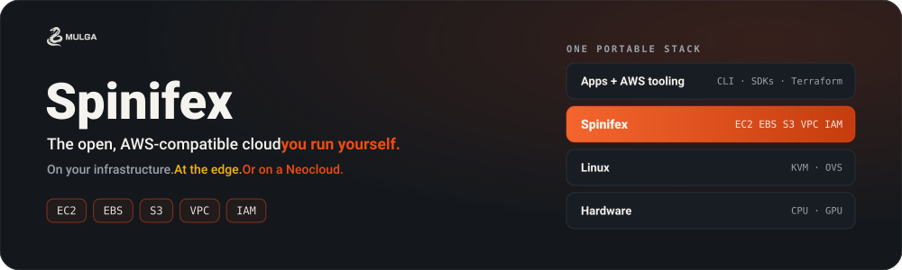
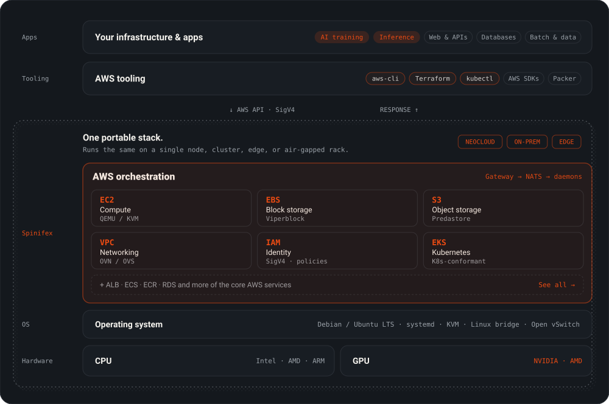
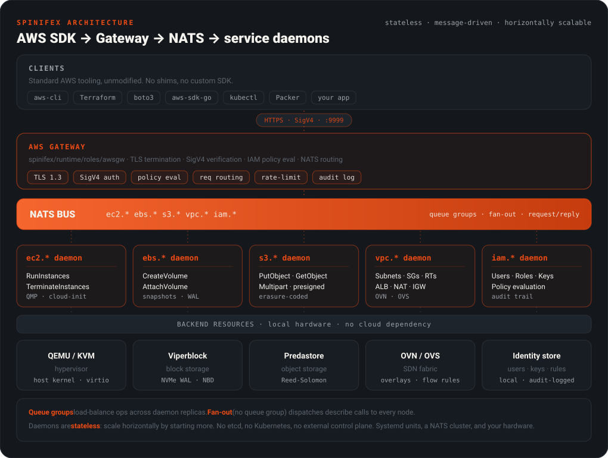

<p align="center">
  
</p>

<p align="center">
  <a href="https://go.dev"></a>
  <a href="https://pkg.go.dev/github.com/mulgadc/spinifex"></a>
  <a href="LICENSE"></a>
  <a href="https://mulgadc.com"></a>
  <a href="https://docs.mulgadc.com"></a>
</p>


<p align="center">
  <a href="#try-it-live">Live Demo</a> ·
  <a href="#services">Services</a> ·
  <a href="#deploy-anywhere">Deploy</a> ·
  <a href="#install">Install</a> ·
  <a href="#architecture">Architecture</a>
</p>

---

# Spinifex: the open, AWS-compatible cloud you run yourself

Spinifex, built by [Mulga](https://mulgadc.com), recreates the AWS services your software already uses on infrastructure you control. Move workloads off the hyperscalers, run AI at a fraction of the cost, or take the cloud to the edge, without rewriting a line.

- **Your AWS tooling, unchanged.** The AWS CLI, SDKs, and Terraform work as they are.
- **Full control of the stack.** Your hardware, data, and keys, with no external control plane, running through disconnection.
- **Open core under AGPL-3.0.** Auditable, yours to keep, with no lock-in.

You change *where* your software runs, not *what* it is.

## Try It Live

Get a real Spinifex endpoint in under a minute, with no card and no install. The sandbox is yours for 72 hours, with access keys, the web console, and EC2, EBS, S3, VPC, IAM, EKS, and RDS ready to call. Point your existing AWS CLI or Terraform straight at it.

**[Create your sandbox →](https://mulgadc.com/signup)**

## Same Commands, Your Cloud

```bash
export AWS_PROFILE=spinifex
aws ec2 describe-images
aws ec2 run-instances --image-id ami-xxxxxxxx --instance-type t3.micro
aws s3 mb s3://my-bucket
```

For Terraform, start from the [example workbooks](https://docs.mulgadc.com/docs/nginx-webserver).

## Why Not LocalStack or Floci?

[LocalStack](https://github.com/localstack/localstack) and [Floci](https://github.com/floci-io/floci) are emulators for local development and CI testing. An emulator returns a plausible response; Spinifex boots the machine. A call launches a real KVM guest, attaches a replicated Viperblock volume, or writes an erasure-coded object into Predastore, so Spinifex can run your production workloads on hardware you own. Test against an emulator, then run in production on Spinifex.

## Services

The platform serves **392 AWS API operations** across the services below. See exactly which ones in the [coverage report](https://docs.mulgadc.com/coverage).

| Service | What it is | Built on | Status |
| --- | --- | --- | --- |
| **EC2** | Compute | QEMU/KVM, with spot instances and GPU passthrough | Available |
| **EBS** | Block storage | [Viperblock](https://github.com/mulgadc/viperblock): replicated, with a WAL on local NVMe | Available |
| **S3** | Object storage | [Predastore](https://github.com/mulgadc/predastore): Reed-Solomon erasure coding | Available |
| **VPC** | Networking | OVN, with security groups | Available |
| **IAM** | Identity & auth | SigV4 across every service | Available |
| **ALB / NLB** | Load balancers | HAProxy (L7), nginx `stream` (L4), with ACM certificates | Available |
| **EKS** | Kubernetes | k3s, with HA control planes and managed node groups | Available |
| **ECR** | Container registry | Predastore, deduplicated per account | Available |
| **ECS** | Container service | Spinifex instances | Available |
| **RDS** | Databases | PostgreSQL and MariaDB, with automated backups | Available |
| **Bedrock** | AI deployment | | Q4 2026 |

Roadmap services ship under the same AWS API surface, so code written for AWS today works the moment they land. [Track what's shipped in the release notes](https://github.com/mulgadc/spinifex/releases).

## Deploy Anywhere

<p align="center">
  
</p>

- **Neocloud:** lift and shift onto partner GPU capacity (H100 / H200 / B200). Change an endpoint, keep the software.
- **On-premise:** a multi-node HA cluster in your own data centre, so the stack, the data, and the jurisdiction stay yours.
- **Edge:** air-gapped sites, vehicles, vessels, factories, and clinics, with compute next to the data.

## Install

Spinifex runs on Ubuntu 26.04 or Debian 13. The full guides are at [docs.mulgadc.com](https://docs.mulgadc.com).

>*Prerequisite:* Spinifex requires a Linux bridge configured on the host for VM networking. See the [single-node install guide](https://docs.mulgadc.com/docs/install#prerequisites) for setup details.

**Bare metal (recommended):** download the [bootable x86 installer](https://iso.mulgadc.com/spinifex.iso) and follow the [USB install guide](https://docs.mulgadc.com/docs/install-usb).

```bash
curl -fLO https://iso.mulgadc.com/spinifex.iso
```

**Single node:**

```bash
curl -fsSL https://install.mulgadc.com | bash
sudo /usr/local/share/spinifex/setup-ovn.sh --management
sudo spx admin init --node node1 --nodes 1
sudo systemctl start spinifex.target
export AWS_PROFILE=spinifex
aws ec2 describe-instance-types
```

**From source:** see the [Source Install](https://docs.mulgadc.com/docs/install-source) guide.

## Web Console

<p align="center">
  
</p>

Spinifex ships with a built-in web console for your instances, volumes, buckets, networks, and IAM. See [Launching the Web UI](https://docs.mulgadc.com/docs/setting-up-your-cluster#7-launching-the-web-ui).

## Architecture

<p align="center">
  
</p>

Every AWS API call is authenticated at the gateway, published to a NATS subject, and answered by whichever daemon claims it. Daemons are stateless, so you scale horizontally by starting more. Deep dive: **[`docs/DESIGN.md`](docs/DESIGN.md)**.

## How We Build Spinifex

Spinifex is built by infrastructure engineers with deep AWS experience, including former AWS team members, drawing on decades of combined work across AWS, enterprise infrastructure, and edge computing. Engineers architect and implement it, with **Claude Code** accelerating parts of the work.

| Claude Code assists with | Engineers own |
| --- | --- |
| Boilerplate AWS API structures and handlers | Architecture and scalability decisions |
| Development guides and API documentation | Authentication, encryption, and threat modelling |
| Test case generation and validation scenarios | Real-world performance tuning and benchmarking |
| Large-scale restructuring and refactoring | Deployment strategy and production operations |

## Trademarks

"AWS", "Amazon Web Services", and all related service names (EC2, EBS, S3, VPC, IAM, and others) are trademarks of Amazon.com, Inc. or its affiliates. Mulga Defense Corporation and Spinifex are independent and not affiliated with, endorsed by, or sponsored by Amazon.com, Inc. or Amazon Web Services, Inc. References to AWS services describe interoperability and compatibility only.

## License

Spinifex is open source under the [GNU Affero General Public License v3.0](LICENSE), with a commercial license available.
