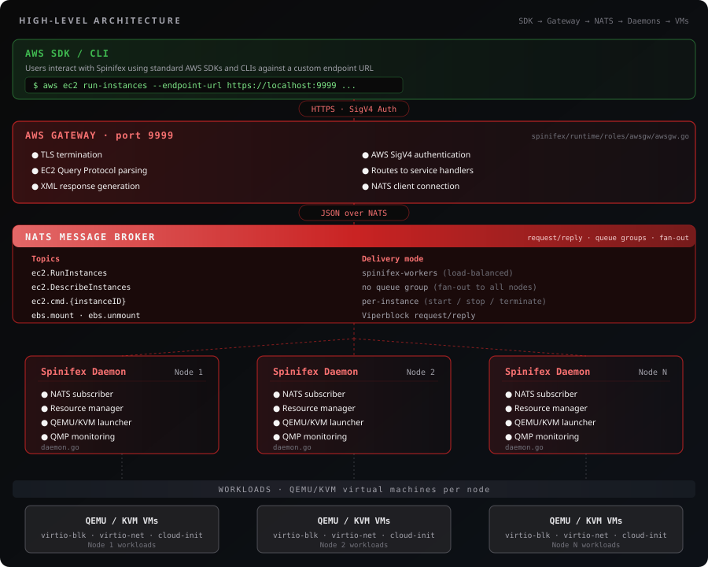

# Spinifex Architecture

Spinifex is an AWS-compatible infrastructure platform for bare-metal, edge, and on-premise deployments. It provides EC2-compatible VM orchestration backed by QEMU/KVM, with storage provided by companion projects Viperblock (EBS) and Predastore (S3).

## High-Level Architecture

<p align="center">
  
</p>

## Request Flow

### 1. AWS SDK Request

Users interact with Spinifex using standard AWS SDKs or the AWS CLI by using the spinifex profile.

```bash
AWS_PROFILE=spinifex aws ec2 run-instances \
    --image-id ami-debian13 \
    --instance-type t3.micro \
    --key-name my-keypair
```

The AWS SDK formats this as an HTTPS POST with:
- AWS SigV4 authentication headers
- EC2 Query Protocol body (`Action=RunInstances&ImageId=ami-debian13&...`)

### 2. AWS Gateway

The gateway (`spinifex/runtime/roles/awsgw/awsgw.go`) is the entry point:

```go
// Connect to NATS (retries while the local broker comes up)
natsConn, err := natsmsg.ConnectNATSWithRetry(...)

// Load IAM (master key + JetStream KV) and create the gateway
gw := gateway.GatewayConfig{
    NATSConn:   natsConn,
    Config:     nodeConfig.AWSGW.Config,
    IAMService: iamService,
    // ...
}

// Serve over TLS
server.ListenAndServeTLS("", "")
```

Request routing (`spinifex/gateway/gateway.go`):

1. **Authentication**: SigV4 middleware validates AWS credentials and resolves the account ID
2. **Throttling**: Per-account+action token bucket rejects bursts post-auth
3. **Service Detection**: Extracts service name from the Authorization header
4. **Action Dispatch**: Routes to service-specific handler. A service registered through the ingress dispatch registry (`ingress/aws/dispatch`, wired by `runtime/roles/awsgw`) is dispatched by its registration; currently those are the ECR and ACM control planes, registered from `domains/ecr/awsapi` and `domains/acm/awsapi`. Every other service uses the legacy switch:

```go
switch svc {
case "ec2":
    err = gw.EC2_Request(w, r)
case "iam":
    err = gw.IAM_Request(w, r)
case "sts":
    err = gw.STS_Request(w, r)
case "elasticloadbalancing":
    err = gw.ELBv2_Request(w, r)
case "eks":
    err = gw.EKS_Request(w, r)
case "bedrock":
    err = gw.Bedrock_Request(w, r)
// ... bedrock-runtime, bedrock-agent, bedrock-agent-runtime
case "ecs":
    err = gw.ECS_Request(w, r)
case "rds":
    err = gw.RDS_Request(w, r)
case "tagging":
    err = gw.Tagging_Request(w, r)
case "spinifex":
    err = gw.Spinifex_Request(w, r)
}
```

### 3. EC2 Handler

The EC2 handler (`spinifex/gateway/ec2.go`) parses the `Action` parameter and delegates to specific handlers via the generic `ec2Handler` and `ec2HandlerWithReq` wrappers. The account ID resolved by SigV4 auth is threaded into every handler so requests are scoped per IAM principal:

```go
"RunInstances": ec2HandlerWithReq(func(ctx context.Context, input *ec2.RunInstancesInput, gw *GatewayConfig, accountID string, r *http.Request) (any, error) {
    // ... PassRole and launch-quota checks, then the vCPU quota charge
    return ec2instanceapi.RunInstances(ctx, input, gw.NATSConn, gw.IAMService, accountID, passRoleCheck, launchQuotaCheck, gw.ExpectedNodes)
}),
"DescribeInstances": ec2Handler(func(ctx context.Context, input *ec2.DescribeInstancesInput, gw *GatewayConfig, accountID string) (any, error) {
    return ec2instanceapi.DescribeInstancesChecked(ctx, input, gw.NATSConn, 0, gw.NodeIDs, accountID)
}),
// ... + volumes, snapshots, VPCs, subnets, route tables, IGWs, NAT gateways,
// security groups, network interfaces, elastic IPs, placement groups, key pairs,
// images, tags, capacity reservations, spot instances
```

### 4. NATS Messaging

The gateway communicates with daemons via NATS request/response. Most calls go through `natsmsg.NATSRequest`, which marshals the input, attaches the account ID as a NATS header, and unmarshals the typed response:

```go
func (s *NATSInstanceService) RunInstances(ctx context.Context, input *ec2.RunInstancesInput, accountID string) (*ec2.Reservation, error) {
    topic := fmt.Sprintf("ec2.RunInstances.%s", aws.StringValue(input.InstanceType))
    return natsmsg.NATSRequest[ec2.Reservation](ctx, s.natsConn, topic, input, 5*time.Minute, accountID)
}
```

The gateway's `RunInstances` places instances itself (`domains/ec2/awsapi/instance/placement.go`): it gathers capacity from every node on `spinifex.node.status`, spreads the launch across eligible nodes, and sends each node its share on the node-targeted subject `ec2.RunInstances.{type}.{nodeId}`, rolling back on partial failure.

### Cross-Process Contract Ownership

NATS subjects and JSON payloads that cross a process boundary are contracts,
not incidental implementation details. A domain owns its named and versioned
contract under `contracts/<domain>/vN`; consumers own only their narrow
in-process capability interfaces, and runtime composition wires the two.

The first realised example is the [EC2 instance-command contract](../contracts/ec2/v1/README.md).
`ec2.cmd.<instance-id>` is deliberately a targeted request/reply route: only
the node that owns the QEMU process may execute a live-instance command. Its
JSON shape and `ec2.cmd.*` subject form are compatibility-tested. The wildcard
matches one final instance-ID token; it is not a broad descendant subscription.

Changing that subject shape or a JSON field is a contract change, not a
refactor. It needs a versioned successor or an explicit compatibility plan.

### 5. Daemon Processing

Daemons (`spinifex/runtime/daemon/daemon.go`) subscribe to NATS topics and handle requests. A table-driven `subscribeAll()` registers the static EC2/ELBv2 surface at startup:

```go
// Queue group → load-balanced (one daemon handles each request)
{"ec2.CreateKeyPair", handleNATSRequest(d.node, d.keyService.CreateKeyPair), "spinifex-workers"},

// No queue group → fan-out (every daemon responds)
{"ec2.DescribeInstanceTypes", handleNATSRequest(d.node, d.instanceService.DescribeInstanceTypes), ""},
```

`ec2.RunInstances` is dynamic: `ResourceManager` subscribes to `ec2.RunInstances.{type}` only while the node has capacity for that type, and unsubscribes when full. The node-targeted subject `ec2.RunInstances.{type}.{nodeId}` stays subscribed even at full capacity — the launch-time `allocate()` enforces limits there. Per-instance commands flow over `ec2.cmd.{instanceID}`, subscribed only by the owning node.

**Queue Groups**: topics with the `spinifex-workers` queue group are load-balanced — only one daemon handles each request. Topics without a queue group fan out to all daemons.

### 6. VM Launch

When a daemon handles `RunInstances`:

1. **Resource Check**: Validates CPU/memory availability via `ResourceManager`
2. **Volume Generation**: Creates boot and EFI volumes via Viperblock
3. **Volume Mount**: Sends a mount request to the colocated Viperblock worker on `ebs.{node}.mount`, receives NBD URI
4. **QEMU Launch**: Builds and executes QEMU command with NBD-backed disks
5. **QMP Monitoring**: Establishes QEMU Machine Protocol connection for VM management
6. **Command subscription**: Subscribes to `ec2.cmd.{instanceID}` for subsequent commands on this VM

```go
// Volume mounting via NATS (runtime/daemon/vm_adapters.go)
reply, err := ebsRequestWithTrace(ctx, a.nc, instance.AccountID, viperblocklegacyv1.MountSubject(a.node), ebsMountRequest, 30*time.Second)

// QEMU launch with NBD-backed drives in args (runtime/compute/vm/vm.go)
cmd := exec.Command(qemuArchitecture, args...) // qemu-system-x86_64 or qemu-system-aarch64
```

## Key Components

### Daemon Structure

```go
type Daemon struct {
    node          string                  // Node identifier
    clusterConfig *config.ClusterConfig   // Cluster-wide configuration
    config        *config.Config          // Node-specific configuration
    natsConn      *nats.Conn              // NATS connection
    resourceMgr   *ResourceManager        // CPU/Memory tracking + dynamic RunInstances subscriptions
    vmMgr         *vm.Manager             // Local VMs
    // ... + one service struct per EC2/ELBv2 resource
    //       (instance, key, image, volume, snapshot, tags, vpc, subnet,
    //        igw, eigw, natgw, routetable, eip, placementgroup, elbv2, ...)
}
```

### Resource Manager

Tracks available and allocated CPU/memory to prevent overcommit, and drives the dynamic `ec2.RunInstances.{type}` subscriptions:

```go
type ResourceManager struct {
    mu            sync.RWMutex
    hostVCPU      int                                // raw runtime.NumCPU
    hostMemGB     float64                            // raw /proc/meminfo MemTotal
    reservedVCPU  int                                // held back for spinifex services
    reservedMem   float64                            // held back for spinifex services
    allocatedVCPU int
    allocatedMem  float64
    instanceTypes map[string]*ec2.InstanceTypeInfo   // t3.micro, t3.small, etc.
    // ... + capacity-reservation accounting, GPU manager, nbdkit memory
    //       overhead tracking, and the dynamic-subscription state
}
```

### Multi-Node Aggregation

For operations that need data from all nodes (like `DescribeInstances`), the gateway uses the scatter-gather helper `natsmsg.Gather` (`spinifex/foundation/messaging/nats/nats.go`), called from `spinifex/domains/ec2/awsapi/instance/DescribeInstances.go`:

```go
// Publish to every node (no queue group = all daemons respond) and collect
// the replies. The account ID travels as a NATS header so each daemon scopes
// its response.
frames, sum, err := natsmsg.Gather(ctx, natsConn, "ec2.DescribeInstances", jsonData, gatherOpts)
```

Given the configured node IDs, `Gather` checks each reply's `X-Node-ID` header against them, and `DescribeInstancesChecked` fails closed rather than returning a partial listing when a node is missing, duplicated or unidentified.

## Storage Integration

### Viperblock (EBS)

Block storage volumes are managed via NATS messages to Viperblock:

```go
// Volume mount request
type EBSRequest struct {
    Name      string  // Volume name (vol-xxxxx)
    VolType   string  // gp2, io1, etc.
    Boot      bool    // Boot volume flag
    EFI       bool    // EFI boot volume
    NBDURI    string  // NBD URI returned from mount
    // ... + DeviceName, DeleteOnTermination, hotplug port and host block-device fields
}
```

Viperblock responds with an NBD URI that QEMU uses to access the block device.

### Predastore (S3)

Object storage used for:
- AMI image storage
- SSH public key storage (`/bucket/ec2/{key-name}.pub`)
- Volume metadata and configuration

Spinifex runs Predastore in-process: `spx service predastore start` loads `/etc/spinifex/predastore/predastore.toml`, selects the `[[host]]` naming this machine, and serves it until the process is signalled. The topology is written by `spx admin init` / `join` from the servers that form the cluster.

One `[[host]]` is one process. The nodes pinned to it under `[[host.node]]` carry the roles:

| Role | Port | Responsibility |
|------|------|----------------|
| `gate` | TCP 8443 | The S3 API. Holds no cluster state; dials the meta and blob nodes to serve a request. |
| `blob` | UDP 6660 | Erasure-coded object shards, encrypted at rest under this host's master key. |
| `meta` | UDP 7660 | Raft replica of global state — buckets and the object index. |

Ports are unique within a host but repeat across the cluster, so a multi-node cluster puts one node of each role on every machine and every machine uses the same three ports. Nodes sharing a host talk over an in-process pipe and bind no socket; nodes on other hosts are reached over QUIC, authenticated by the cluster CA.

A single-node install is the same arrangement with one host: seven nodes — a gate, three blob and three meta — colocated in one process, needing seven distinct ports (8443, 6660–6662, 7660–7662) to stay unique within the host even though only the gate opens a listener. It has no code path of its own.

The daemon reports the topology on `spinifex.storage.config` (the
`contracts/operator/v1` Predastore-topology contract) by parsing the config
file. It does not connect to Predastore to do so, and no Predastore node
exposes a status endpoint. This is an operator status interface, not a generic
storage-provider contract.

## Configuration

Cluster configuration (`spinifex/bootstrap/config/config.go`):

```go
type ClusterConfig struct {
    Epoch     uint64            // Incremented on config changes
    Node      string            // This node's identifier
    Version   string            // Spinifex version
    Network   NetworkConfig     // Cluster-wide external network settings (IP pools, IPsec)
    Bootstrap BootstrapConfig   // Default VPC IDs written by admin init
    AWS       AWSConfig         // Cluster-wide AWS-parity settings (region, endpoint suffix)
    Nodes     map[string]Config // Configuration for all nodes
}

type Config struct {
    Node, Host, AdvertiseIP  string
    Region, AZ               string
    BaseDir, DataDir, WalDir string
    Services   []string         // Which services this node runs locally
    Daemon     DaemonConfig
    NATS       NATSConfig       // Broker address, JetStream, ACL token, CA cert
    AWSGW      AWSGWConfig      // Gateway host, TLS certs, throttle config
    Predastore PredastoreConfig // S3 endpoint + service credentials
    Viperblock ViperblockConfig
    VPCD       VPCDConfig       // OVN/OVS endpoints
    // ... + EBS, Northstar, RDS, ACM, Bedrock, OchreVector
}
```

Configs are generated by `spx admin init` (leader) or `spx admin join` (followers).

## File Structure

The layout follows Mulga ADR-0001 (Spinifex package boundary and layout).
`architecture/layering` enforces its dependency rules in `make preflight`.

```
spinifex/
├── cmd/                     # Thin executable mains: spx, installer, in-guest agents, dev tools
├── contracts/               # Versioned cross-process wire contracts (contracts/<domain>/vN)
├── spinifex/
│   ├── foundation/          # Shared primitives: AWS errors/ARNs/filters/tags, KV state, messaging, telemetry, PKI
│   ├── providers/           # Backend adapters: EBS (Viperblock), object store, cloud (OCI, Exoscale)
│   ├── domains/             # Service domains (ec2, acm, ecr, dns, network, ochre, rds, tagging, ...)
│   │   └── <domain>/awsapi/ # A domain's AWS action adapters
│   ├── ingress/             # AWS protocol ingress: query/REST parsing, dispatch registry, rate limiting
│   ├── runtime/
│   │   ├── roles/           # Long-running service roles (awsgw, spinifex, vpcd, nats, predastore, ...)
│   │   ├── daemon/          # Per-node daemon and its NATS subscription table
│   │   └── compute/         # VM lifecycle, QMP, NBD, GPU
│   ├── bootstrap/           # Cluster and node configuration structures, preflight checks
│   ├── operator/            # spx CLI commands, admin use cases, installer, upgrade
│   ├── agents/              # In-guest agent libraries (ecs, eks, elbv2, rds)
│   ├── gateway/             # Legacy root: HTTP route assembly, SigV4 auth, legacy per-service dispatch
│   ├── handlers/            # Legacy root: ecs and elbv2 service implementations
│   └── accountteardown/     # Legacy root: account deletion cleanup
├── internal/                # In-guest SigV4 clients, AWS Smithy models and test kits
├── architecture/            # Executable architecture rules (package layering)
├── build/                   # systemd units, node helper scripts, microVM build
├── scripts/                 # Install, dev-environment, image-build scripts
└── tests/
    ├── integration/         # Gateway router against embedded NATS JetStream
    └── e2e/                 # Live-cluster suites (see docs/testing/e2e-coverage.md)
```

The three remaining legacy roots predate ADR-0001 and are frozen: they may shrink but not gain packages.
[`PACKAGE_BOUNDARY_MIGRATION.md`](PACKAGE_BOUNDARY_MIGRATION.md) records what remains in each and what blocks its move.

## Development

### Running the Stack

```bash
sudo spx admin init --node node1 --nodes 1
sudo systemctl start spinifex.target
```

`spx admin init` generates the cluster CA, IAM credentials, TLS certs, and AWS CLI `spinifex` profile, then writes config to `/etc/spinifex/` and data to `/var/lib/spinifex/`. `spinifex.target` brings up all services (NATS, Predastore, Viperblock, vpcd, the daemon, awsgw, the UI) under systemd. Use `spx admin join` for additional nodes.

### Testing with AWS CLI

```bash
export AWS_PROFILE=spinifex

# Run instance
aws ec2 run-instances --image-id ami-debian13 --instance-type t3.micro

# List instances (queries all nodes)
aws ec2 describe-instances

# Terminate instance
aws ec2 terminate-instances --instance-ids i-xxxxx
```

For cluster-state inspection that bypasses the AWS API surface, use the `spx` CLI directly: `spx get nodes`, `spx get vms`, `spx top nodes`.
