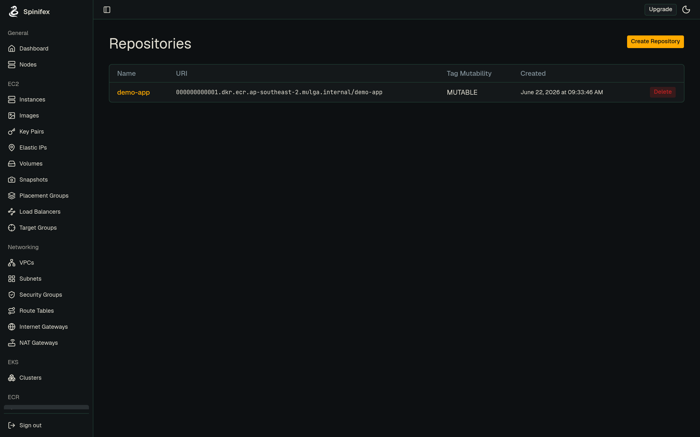
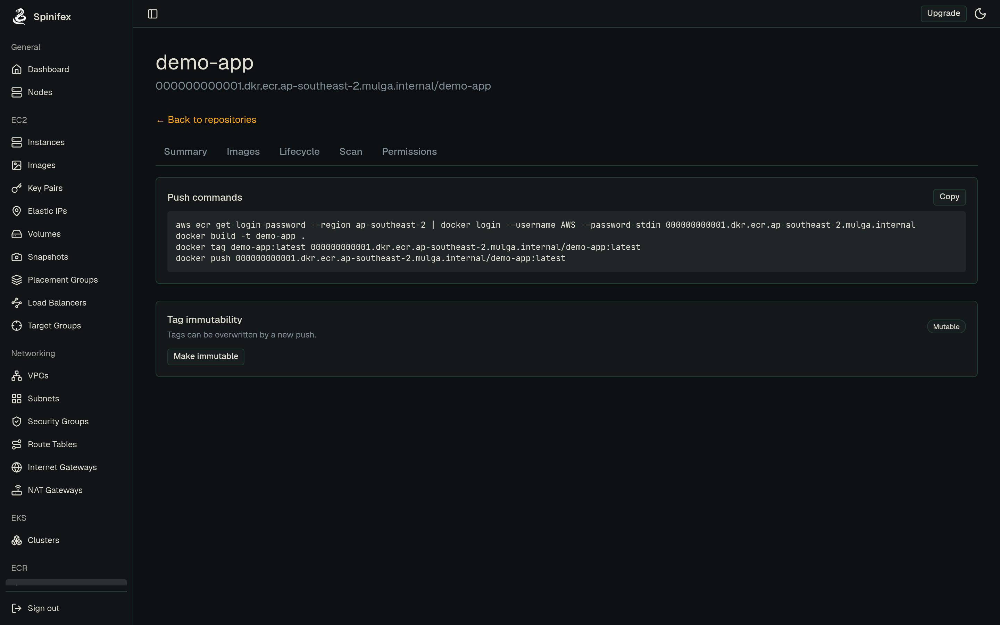

# ECR (Container Registry)

> Spinifex's ECR service is an AWS-compatible, OCI-compliant container registry. You create repositories with `aws ecr`, authenticate Docker with a registry token, and `docker push` / `docker pull` exactly as you would on AWS — and your EKS clusters can pull from it directly.

## Overview

ECR on Spinifex serves a private container registry on the Spinifex gateway endpoint — the same `host:9999` you already use for the AWS API. Authentication is account-scoped by token, so you push and pull at the gateway host and never need extra DNS:

```
<spinifex-gateway-host>:9999/<repository>
```

`aws ecr describe-repositories` and `aws ecr get-login-password` return the exact host to use — always prefer that value. Where real DNS is configured, the AWS-parity per-account host `<account-id>.dkr.ecr.<region>.<your-spinifex-domain>:9999` also works.

Each repository holds image manifests and their layers. Images are stored in object storage ([Predastore](https://github.com/mulgadc/predastore)) in a per-account bucket, with blobs content-addressed and de-duplicated across repositories. Authentication is token-based: `aws ecr get-login-password` mints a short-lived bearer token that `docker login` uses against the registry's `/v2/` endpoint.

**What works today**

- Repository lifecycle — `CreateRepository`, `DeleteRepository`, `DescribeRepositories`.
- OCI push and pull — blobs, manifests, and tags, including cross-repository blob mounts.
- OCI 1.1 referrers — the referrers API, so cosign v3 signatures and other artifacts attached to an image can be listed (see [OCI referrers and image signing](#oci-referrers-and-image-signing)).
- Token auth — `GetAuthorizationToken` plus bearer/basic auth on `/v2/`.
- Repository policies — set, get, and delete a repository policy document.

**Current limitations**

- **Image scanning is not supported** — scan APIs return an explicit "operation not supported" error.
- **No automatic garbage collection yet** — deleting images does not yet reclaim underlying blobs.
- Lifecycle-policy enforcement and tag-immutability enforcement are not active.

## Prerequisites

- **Spinifex running**, with the AWS CLI configured for the `spinifex` profile (see [Installing Spinifex](/docs/install)).
- **Docker** installed locally to build, push, and pull images.
- **Docker trusting the Spinifex CA.** The registry serves TLS signed by the Spinifex local CA. Install it into the host trust store once (Docker uses the host root pool for registry TLS, so this covers every account endpoint without per-host config):

```bash
sudo cp /etc/spinifex/ca.pem /usr/local/share/ca-certificates/spinifex-local-ca.crt
sudo update-ca-certificates
sudo systemctl restart docker
```

  This reaches dockerd and anything running directly on the host.
  A tool that runs in its own container, or a buildx builder using the `docker-container` driver, has a separate trust store; see [Troubleshooting](#troubleshooting).

- **The registry endpoint** — the Spinifex gateway `host:9999`. `aws ecr get-login-password` and `aws ecr describe-repositories` return the exact `host:port`; copy it from there rather than constructing it by hand.
- **For EKS pulls:** worker nodes need the `AmazonEC2ContainerRegistryReadOnly` policy on their node IAM role (the EKS prerequisites already include this) and network egress to the registry endpoint.

## Instructions

Create a repository and push an image using your preferred tool.

:::tabs
@tab AWS CLI

### 1. Create a repository

```bash
export AWS_PROFILE=spinifex

aws ecr create-repository --repository-name my-app
aws ecr describe-repositories --repository-names my-app \
  --query 'repositories[0].repositoryUri'
```

The `repositoryUri` is the value you tag and push to — the gateway `host:9999` with the repository path, port included (for example `192.0.2.10:9999/my-app`). Use it verbatim; don't hand-build a hostname.

### 2. Authenticate Docker

Take the registry host straight from the API so the `:9999` port is correct:

```bash
REGISTRY=$(aws ecr describe-repositories --repository-names my-app \
  --query 'repositories[0].repositoryUri' --output text | cut -d/ -f1)

aws ecr get-login-password --region <region> \
  | docker login --username AWS --password-stdin "$REGISTRY"
```

### 3. Build, tag, and push

```bash
docker build -t my-app:latest .
docker tag my-app:latest "$REGISTRY/my-app:latest"
docker push "$REGISTRY/my-app:latest"
```

### 4. Verify and pull

```bash
aws ecr describe-images --repository-name my-app
docker pull "$REGISTRY/my-app:latest"
```

@tab Spinifex UI

From the left navigation open **ECR → Repositories**.



### 1. Create a repository

1. Click **Create Repository**.
2. Enter the **repository name** and, optionally, set **tag mutability** (mutable or immutable).
3. Submit — the repository appears in the list with its full registry URI.

### 2. Copy the push commands

Open the repository to see its detail page. The **Push commands** panel lists the exact `aws ecr get-login-password | docker login`, `docker build`, `docker tag`, and `docker push` commands, pre-filled with your registry host and repository URI — use the **Copy** button and run them locally.



### 3. Manage the repository

- The **Permissions** tab edits the repository's access policy.
- The **Lifecycle** tab manages retention rules, and **Tag immutability** can be toggled from the detail page.
- The **Scan** tab reflects that image scanning is not supported on Spinifex.
- Delete a repository from the **Delete** action in the repositories list.

@tab Terraform

Repositories can be managed as code with the standard `aws_ecr_repository` resource, with the AWS provider pointed at Spinifex's `ecr` endpoint:

```hcl
provider "aws" {
  region = "ap-southeast-2"

  endpoints {
    ecr = "https://<your-spinifex-gateway>"
    sts = "https://<your-spinifex-gateway>"
  }
}

resource "aws_ecr_repository" "my_app" {
  name = "my-app"
}

output "repository_url" {
  value = aws_ecr_repository.my_app.repository_url
}
```

```bash
export AWS_PROFILE=spinifex
tofu init
tofu apply
```

Then authenticate Docker and push using the `repository_url` output, following steps 2–4 in the AWS CLI tab.

:::

## EKS workers and multiple gateways

Each gateway puts its own address in the `repositoryUri` it returns, so repositories created through different gateways can carry different hosts.
When an EKS worker launches, the daemon that launches it writes every cluster gateway into the worker's registry mirrors, TLS trust and credential-provider config.
A pod can then pull from any `repositoryUri` host in the cluster.
The worker tries the gateway named in the image reference first and falls back to the others in cluster order.

Limits:

- The gateway list comes from the cluster config the launching daemon loaded at start.
  A gateway added later is not trusted by existing workers; restart the launching daemon and replace the worker.
- Peer gateways are assumed to listen on port 9999.
  A hand-edited `awsgw` bind on a peer is not covered.
- A gateway address that does not answer costs about 30 seconds on each cold pull while the worker's connection attempt gives up.
  A stopped gateway on a host that is still up refuses the connection, and the worker moves to the next gateway at once.

Measured on a single-node environment: pulls by `repositoryUri` and by the account's ECR DNS name, a pull rejected with `x509: certificate signed by unknown authority` when the gateway host was not in the worker config, and a 31 second pull through an unreachable first endpoint.
Measured on a 3-node environment: a pod pulling each of the three gateways' `repositoryUri` on a worker launched with this change (two of the three failed with `x509` on a worker launched without it), and a pull of the stopped gateway's own `repositoryUri` that succeeded through another gateway within one retry (the pull itself took 147 ms after the first endpoint refused).

## OCI referrers and image signing

A manifest can name another manifest as its `subject`, which is how tools such as cosign v3 attach signatures and SBOMs to an image.
The registry records the subject when the manifest is pushed and answers with an `OCI-Subject` header on the `201`.
The `subject` does not have to exist in the repository when the referrer is pushed.

`GET /v2/<name>/referrers/<digest>` lists the manifests that name `<digest>` as their subject.
The request is authorised as `ecr:BatchGetImage` on the repository.
The response is `200` with `Content-Type: application/vnd.oci.image.index.v1+json` and an index whose `manifests` hold each referrer's `mediaType`, `digest`, `size`, `artifactType` and annotations.
A digest with no referrers, or one that is not stored, returns an empty index.
A malformed digest returns `400` with `DIGEST_INVALID`.

Adding `?artifactType=<type>` returns only referrers of that type and sets `OCI-Filters-Applied: artifactType`.
The header is also set when nothing matches.
An image manifest without an `artifactType` is listed under its config `mediaType`; an index without one has none.

Deleting an image by digest (`DELETE /v2/<name>/manifests/<digest>`, `aws ecr batch-delete-image` with `imageDigest`) also deletes its referrers, and their referrers in turn.
Deleting by tag removes only the tag and leaves the image and its referrers.

cosign v3 sign and verify work against the registry, including on a child manifest of an image index copied with `cosign copy`.
cosign v2 keeps writing its `sha256-<digest>.sig` tags and is unaffected.
`GET` on a manifest still returns `406` when the request's `Accept` header does not include the stored `mediaType`.

Limits:

- `cosign copy` does not copy v3 signatures to the destination repository.
  This is client behaviour; sign the copy again.
- Referrers pushed before this version are not listed.
  Push them again to add them to the index.
- A crash between deleting an image and deleting its referrers can leave referrers behind that nothing lists.
- The referrers listing is not paginated.
- `HEAD` on the referrers route is not served.

Measured on a 3-node environment with cosign v3.1.4 and v2.6.5:

- cosign v3.1.4 signed a fresh image index, with one `GET /referrers` answered `200`, no `sha256-<digest>` tag written and no `406`.
- Verify passed.
- A copied index's child manifest signed and verified, which returned `406` before this change.
- The listing returned the signature with its `artifactType`, the filter returned one entry for the signature's type and none for another type.
- `aws ecr batch-delete-image` of the signed image left an empty listing and `404` for both the signature and the image.
- cosign v2.6.5 signed and verified a fresh image.

Not measured: `oras`, `notation`, a listing with many referrers, and a crash in the middle of a delete.

## Troubleshooting

**`docker login` fails with an authorization error.** The token is account-scoped and short-lived. Re-run `aws ecr get-login-password` to mint a fresh token, and confirm the registry host in `docker login` matches your account's endpoint (`aws ecr describe-repositories` returns it).

**`docker push` cannot reach the registry.** Use the exact host from `aws ecr describe-repositories` — the Spinifex gateway `host:9999`. Docker dials it directly, so the `:9999` port must be present (without it docker tries `:443` and fails). If you are using the AWS-parity `<account-id>.dkr.ecr…` hostname instead, that path needs DNS resolving it to the gateway — prefer the gateway host the API returns.

**A containerised tool fails with `x509: certificate signed by unknown authority`, while `docker login` and `docker push` work from the host.**
The registry token exchange (`POST /v2/token`) runs in the process that issued the build or push.
When that process is itself a container, such as `ghcr.io/basecamp/kamal` or a containerised CI runner, it checks the registry certificate against the container's trust store, which does not hold the Spinifex CA.
Bind-mount the host bundle, which already includes the CA after `update-ca-certificates`, over the container's bundle:

```bash
docker run --rm -it \
  -v /etc/ssl/certs/ca-certificates.crt:/etc/ssl/certs/ca-certificates.crt:ro \
  -v /var/run/docker.sock:/var/run/docker.sock \
  -v "$PWD:/workdir" \
  ghcr.io/basecamp/kamal:latest deploy
```

Mounting the whole bundle keeps the public roots, so pulls of public base images still verify.
Pointing `SSL_CERT_FILE` at `ca.pem` alone replaces them and breaks those pulls.

**`docker buildx build --push` fails with an x509 error, while `docker push` of the same image works.**
The buildx driver decides whose trust store BuildKit uses.
The `docker` driver runs the BuildKit built into dockerd, which uses the host trust store, so the host CA install above covers it.
The `docker-container` driver, the default for a builder made with `docker buildx create`, runs BuildKit in its own container, and a CA installed on the host or mounted into the CLI container does not reach it.

Use the `docker` driver when you can (`docker buildx use default`, or `builder: driver: docker` in Kamal's `config/deploy.yml`).
The `docker-container` route is unavoidable for multi-platform builds and remote builders, which the `docker` driver cannot do.
For those, give BuildKit the CA through its own config:

```toml
# buildkitd.toml
[registry."<spinifex-gateway-host>:9999"]
  ca = ["/etc/spinifex/ca.pem"]
```

```bash
docker buildx create --name spinifex --driver docker-container \
  --buildkitd-config buildkitd.toml --use
```

`docker buildx create` copies the referenced CA file into the builder container, so recreate the builder after a CA rotation.

**EKS workers cannot pull an image.** Confirm the node IAM role has `AmazonEC2ContainerRegistryReadOnly` and that the workers have egress to the registry endpoint (an Internet Gateway or NAT Gateway route). See the [EKS prerequisites](/docs/eks).

**Image-scanning commands return an error.** Image scanning is not supported on Spinifex; the scan APIs intentionally reject these calls. Remove scan-on-push configuration from your tooling.

**A pushed image still appears after deletion frees no space.** Garbage collection of unreferenced blobs is not yet automatic — deleting an image removes its manifest and tags but does not immediately reclaim the underlying layers.
