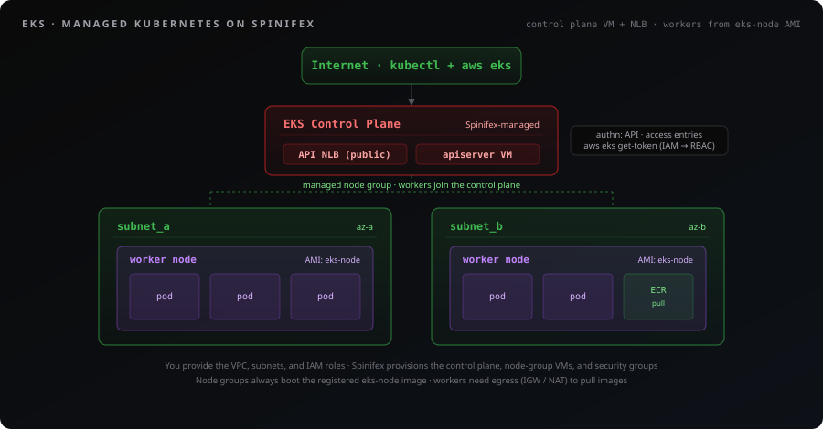
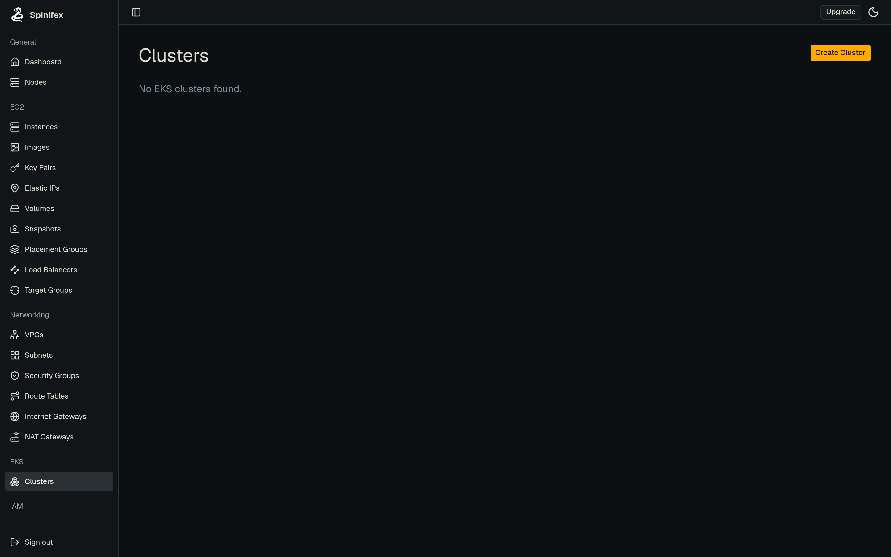
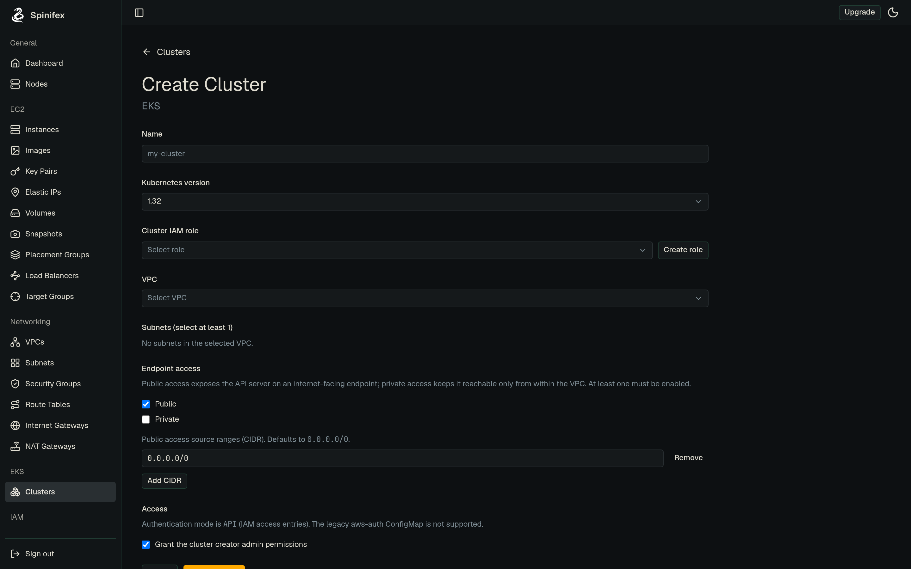

# EKS (Managed Kubernetes)

> Spinifex's EKS service gives you a managed, AWS-compatible Kubernetes API: you create a cluster and a node group, and Spinifex provisions and runs the control plane and workers for you. Standard tools — `aws eks`, `kubectl`, the Terraform AWS provider — work unchanged against your cluster.

## Overview

An EKS cluster on Spinifex has two parts: a **control plane** (the managed Kubernetes API server, provisioned on a Spinifex-managed VM and fronted by a network load balancer) and one or more **managed node groups** of worker VMs that run your pods. You provide the VPC, subnets, and IAM roles; Spinifex creates and reconciles the cluster, its load balancer, and its security groups.

Control-plane hosts are not Kubernetes Nodes, as on AWS: `kubectl get nodes` lists only your node group workers, so a cluster with no node group lists none, and no pod runs on a control-plane host. Add-ons that used to tolerate the control-plane `CriticalAddonsOnly` taint, such as CoreDNS, metrics-server and konnectivity-agent, run on workers, so a Ready worker is required before they become available.

Authentication uses **EKS access entries** (the API authentication mode) — IAM principals are mapped to Kubernetes RBAC groups, and `kubectl` authenticates with `aws eks get-token` exactly as it does on AWS.

<p align="center">
  
</p>

**What you'll create:**

| Resource | Purpose |
|---|---|
| VPC + subnets | The network the cluster and workers run in |
| Internet Gateway / NAT Gateway | Egress so workers can pull container images |
| Cluster IAM role | Lets the control plane manage cluster resources |
| Node IAM role | Lets workers join the cluster and pull images |
| EKS cluster | The managed Kubernetes API endpoint |
| Managed node group | The worker VMs that run your pods |
| Security-group rule | Opens your app's port to reach the workers |

**Spinifex specifics**

- **Access entries are the only auth path.** `authentication_mode` accepts `API` (the default when unset) and `API_AND_CONFIG_MAP`; bare `CONFIG_MAP` is rejected. Spinifex has no `aws-auth` ConfigMap path, so `API_AND_CONFIG_MAP` behaves as `API`: grant access with access entries.
- **Security groups are auto-managed.** Spinifex creates the cluster and node-group security groups deterministically (e.g. `eks-cluster-<name>-nodegroup-sg`); `vpc_config.security_group_ids` is ignored. To expose a workload you add an ingress rule to the auto-managed node-group SG.
- **The worker image is fixed.** Node groups always boot Spinifex's `eks-node` image. `ami_type` is recorded but does not select the image, and the image must be registered on the cluster before you create a node group.
- **Workers launch with IMDSv2 required and an IMDS hop limit of 2.**
  This matches AWS managed node groups and lets a pod without IRSA reach the node role through the SDK default credential chain.
  A node group launch template that sets `metadata_options` overrides each field it sets, and any field it leaves unset keeps the default.
  Existing workers keep their hop limit until they are replaced or changed with `ModifyInstanceMetadataOptions`.
- **Default Kubernetes version is `1.32`.**

### Control plane readiness and kubectl authentication

Each control-plane VM authenticates `kubectl` tokens through a webhook that calls the AWS gateway on the host the VM runs on.
When that gateway is stopped, the webhook cannot validate tokens and `kubectl` reports `Unauthorized` for the share of requests that the load balancer sends to that control plane.

The webhook serves `/readyz` on port 8444 of each control-plane VM.
It returns 200 only when the host gateway answers a TLS handshake and the local API server accepts a TCP connection, and 503 otherwise.
The API server target group health-checks `HTTP :8444/readyz` every 5 seconds with a healthy and unhealthy threshold of 2.
The target group still forwards TCP on 6443.
A control plane that cannot authenticate leaves rotation, and returns when its gateway is back.

Measured on a three-node cluster, one control plane per host, with `kubectl get ns` run continuously after stopping one gateway:

| Gateway stopped | Result |
| --- | --- |
| Host without the cluster load balancer VM, first run | 4 of 20 calls failed in the first round, 0 of 20 in the next round 54 s after the stop |
| Host without the cluster load balancer VM, second run | 2 failures in 100 s, at 3 s and 8 s after the stop |
| Host running the cluster load balancer VM | Not fixed: 20 of 60 calls failed over 100 s |

Before this change the same test failed 3, 4 and 3 calls of 10 per stopped gateway.

Limits:

- Only clusters created with the current `eks-node` image get the readiness listener, and only clusters created from now on get the health check on the target group.
  Older clusters keep the TCP check on 6443 and are not changed.
- A cluster created with an older image gets the health check on its target group but no listener on 8444, so every control plane fails the check and the load balancer fails open to all of them.
- A stopped gateway on the host that runs the cluster load balancer VM is not covered.
  The load balancer VM reports target health through its own host's gateway, so while that gateway is down the unhealthy control plane stays in rotation.
- Not measured: more than one control plane per host, a physical-node failure instead of a stopped gateway, and the target health state as `DescribeTargetHealth` reports it, because the load balancer and control-plane VMs belong to the system account.

### IAM roles for service accounts in your workloads

A pod gets an IAM role by running under a ServiceAccount that carries the role ARN in an annotation.
No pod-spec wiring is needed.

```yaml
apiVersion: v1
kind: ServiceAccount
metadata:
  name: app
  annotations:
    eks.amazonaws.com/role-arn: arn:aws:iam::123456789012:role/app-role
```

Every control plane runs a mutating webhook that acts on pod creation.
When the pod's ServiceAccount has the annotation, the webhook adds these to each container and init container:

- `AWS_ROLE_ARN` and `AWS_WEB_IDENTITY_TOKEN_FILE`, with a projected token volume named `aws-iam-token` mounted at `/var/run/secrets/eks.amazonaws.com/serviceaccount`.
- `AWS_REGION`, `AWS_DEFAULT_REGION` and `AWS_STS_REGIONAL_ENDPOINTS`.
- `AWS_ENDPOINT_URL_STS`, so the SDK calls the Spinifex STS endpoint.
- `AWS_CA_BUNDLE`, pointing at `/etc/spinifex/ca-bundle/ca.pem`, a ConfigMap named `spinifex-ca-bundle` that is created in every namespace and holds the system roots plus the gateway CA.
- `SSL_CERT_FILE` with the same path, only when the container does not set it. Clients such as the AWS Load Balancer Controller read this variable instead of `AWS_CA_BUNDLE`.

Your workload still sets `AWS_ENDPOINT_URL` (or the per-service variable) for every service other than STS.

The token audience defaults to `sts.amazonaws.com`.
The expiry defaults to a value between 79200 and 86400 seconds and is clamped to 600 to 86400 seconds.
Set them with the `eks.amazonaws.com/audience` and `eks.amazonaws.com/token-expiration` annotations on the ServiceAccount.
The `token-expiration` annotation on the pod wins over the ServiceAccount.

A container is left alone when it already has the role, region and regional STS settings, which is how the managed add-ons and your own explicit wiring are skipped.
When some are present, the missing ones and the mount are added.
Containers named in the pod's `eks.amazonaws.com/skip-containers` annotation (comma separated) are not touched.
A pod whose ServiceAccount has no role annotation is not changed.

The webhook fails open: if it cannot decide, the pod is created without injection.
Each injection, skip and failure is logged with the namespace, pod and reason in the control-plane console log.
Because it fails open, a pod that needs a role but starts without credentials is the symptom to look for, and the console log says why.

The webhook listens on `127.0.0.1:8445` of each control plane, and each API server calls its own.
Port 8444 is a different listener, the readiness check described above.

Existing clusters get the webhook only when their control planes are replaced by the current `eks-node` image.
No user-facing operation replaces a control plane, and automatic replacement does not currently work when the replacement reuses the failed member's IP.
Recreate the cluster to adopt it.
User-workload injection through a cluster created with an older image is not measured.

### Add-on versions

Add-on versions use the AWS form `v<x.y.z>-eksbuild.<n>`, for example `v1.40.1-eksbuild.1`.
`DescribeAddonVersions` returns versions in this form, newest first, and every other add-on response reports the version the same way.
Spinifex ships one EKS build of each upstream version, so `<n>` is `1` today.

`DescribeAddonVersions` honours `addonName`, `kubernetesVersion`, `types`, `publishers`, `owners`, `maxResults` and `nextToken`.
Each version carries `compatibilities` with the `clusterVersion`, the `platformVersions`, and a `defaultVersion` flag that is true for exactly one version per add-on and cluster version.
A `kubernetesVersion` that Spinifex does not run returns no add-ons.

`CreateAddon` and `UpdateAddon` accept the AWS form of a version in the catalogue.
They also accept the bare upstream form, such as `1.40.1`, and Spinifex logs each use at Info.
This is a Spinifex leniency that AWS does not offer, and it exists so that older scripts keep working.
Any other value is refused with a message that names `addonVersion` and lists the supported versions, for example `v1.40.1-eksbuild.2`, `1.40` or `v1.40.1`.

In Terraform, pass the AWS form to `aws_eks_addon.addon_version`, either as a literal or from `data.aws_eks_addon_version`.
The AWS provider validates the format before it calls the API, so it rejects the bare form.
Leaving `addon_version` unset still installs the catalogue default.

## Prerequisites

> [!IMPORTANT]
> **Prerequisite — `eks-node` image required.**
>
> Node groups always boot Spinifex's **`eks-node`** image, and it **must** be registered before you create a cluster — the console blocks cluster creation until it is present. Import it during `spx admin init` (or via the image catalogue) ahead of time.
>
> **Verify before continuing:**
>
> ```bash
> aws ec2 describe-images \
>   --filters 'Name=tag:spinifex:managed-by,Values=eks' \
>   --query 'Images[].[ImageId,Name]' --output text
> ```
>
> No rows means the image is not imported — register it before continuing.

Before creating a cluster you need the supporting infrastructure in place. The Terraform workbooks build all of this for you; if you are using the CLI or console, create it first.

- **Spinifex running**, with the AWS CLI configured for the `spinifex` profile (see [Installing Spinifex](/docs/install)) and `kubectl` installed.
- **The `eks-node` image** registered on the cluster. The console blocks cluster creation until it is present.
- **A VPC with at least one subnet.** The control plane launches in your first subnet; workers run in the subnets you pass to the node group.
- **Egress for the workers.** Workers must reach the internet to pull container images.
- **Public workers** need an **Internet Gateway** with a default route (`0.0.0.0/0 → IGW`) and public IPs.
- **Private workers** need a **NAT Gateway** in a public subnet with a default route (`0.0.0.0/0 → NAT`) from the private subnets.
- **A cluster role** trusted by `eks.amazonaws.com` with `AmazonEKSClusterPolicy` attached.
- **A node role** trusted by `ec2.amazonaws.com` with `AmazonEKSWorkerNodePolicy`, `AmazonEKS_CNI_Policy`, and `AmazonEC2ContainerRegistryReadOnly` attached (the last lets workers pull images from [ECR](/docs/ecr)).

## Instructions

The same cluster can be created three ways. Pick your tool — each path reaches the same working cluster.

:::tabs
@tab AWS CLI

### 1. Create the cluster

Point the cluster at your VPC subnets and the cluster role, with API authentication and a public endpoint:

```bash
export AWS_PROFILE=spinifex

aws eks create-cluster \
  --name demo \
  --role-arn arn:aws:iam::000000000000:role/eks-cluster-role \
  --resources-vpc-config subnetIds=subnet-aaaa,subnet-bbbb,endpointPublicAccess=true \
  --access-config authenticationMode=API \
  --kubernetes-version 1.32
```

Wait for it to become active:

```bash
aws eks wait cluster-active --name demo
aws eks describe-cluster --name demo --query 'cluster.status'
```

### 2. Add a node group

```bash
aws eks create-nodegroup \
  --cluster-name demo \
  --nodegroup-name default \
  --node-role arn:aws:iam::000000000000:role/eks-node-role \
  --subnets subnet-aaaa subnet-bbbb \
  --scaling-config minSize=1,maxSize=2,desiredSize=1 \
  --instance-types t3.medium

aws eks wait nodegroup-active --cluster-name demo --nodegroup-name default
```

### 3. Connect kubectl

```bash
aws eks update-kubeconfig --name demo
kubectl get nodes
```

The list shows the node group workers only. The control-plane VMs never appear as Nodes.

### 4. Expose a workload

Workers join an auto-managed security group that only allows intra-cluster traffic. To reach a NodePort service, add one ingress rule to that SG (look it up by its deterministic name):

```bash
SG=$(aws ec2 describe-security-groups \
  --filters Name=group-name,Values=eks-cluster-demo-nodegroup-sg \
  --query 'SecurityGroups[0].GroupId' --output text)

aws ec2 authorize-security-group-ingress \
  --group-id "$SG" --protocol tcp --port 30080 --cidr 0.0.0.0/0
```

Then deploy and publish your app:

```bash
kubectl create deployment hello --image=nginxdemos/hello --replicas=2
kubectl expose deployment hello --type=NodePort --port=80 \
  --overrides='{"spec":{"ports":[{"port":80,"nodePort":30080}]}}'
```

@tab Spinifex UI

The Spinifex console drives the same workflow through a guided form. From the left navigation open **EKS → Clusters**.



### 1. Create the cluster

1. Click **Create Cluster**.
2. Enter a **name** and choose the **Kubernetes version** (default `1.32`).
3. Choose the **cluster IAM role**, or create one inline from the dialog.
4. Select the **VPC and subnets** the cluster will run in.
5. Set **endpoint access** (public, private, or both) and submit.



The form notes that the authentication mode is API and that the legacy aws-auth ConfigMap is not supported. The cluster appears in the **Clusters** list as `CREATING` and flips to `ACTIVE` once the control plane is healthy.

### 2. Add a node group

1. Open the cluster and switch to the **Node groups** tab.
2. Click **Add node group**, choose the **node IAM role**, **subnets**, **instance type**, and **scaling** (desired / min / max).
3. Submit and wait for the node group to reach `ACTIVE`.

### 3. Manage access and addons

- The **Access** tab lists IAM principals and their cluster-access policies — add an access entry to let another user or role reach the cluster.
- The **Addons** tab installs and shows the health of managed addons.
- The **Networking** tab shows the cluster's VPC, subnets, endpoint access, and the auto-managed security groups.

To run `kubectl` against the cluster, follow the AWS CLI tab's `update-kubeconfig` step.

@tab Terraform

The Terraform workbooks are the fastest way to a working cluster — they build the VPC, IAM roles, cluster, node group, and a demo workload in one `apply`. Start with **eks-quickstart**:

```bash
git clone --depth 1 --filter=blob:none --sparse https://github.com/mulgadc/spinifex.git spinifex-tf
cd spinifex-tf
git sparse-checkout set docs/terraform-workbooks
cd docs/terraform-workbooks/eks-quickstart
```

The cluster config points the AWS provider at Spinifex's `eks`, `ec2`, `iam`, and `sts` endpoints, then creates the cluster and node group:

```hcl
resource "aws_eks_cluster" "this" {
  name     = "eks-quickstart"
  role_arn = aws_iam_role.cluster.arn
  version  = "1.32"

  access_config {
    authentication_mode = "API"
  }

  vpc_config {
    subnet_ids              = [aws_subnet.a.id, aws_subnet.b.id]
    endpoint_public_access  = true
  }
}

resource "aws_eks_node_group" "default" {
  cluster_name    = aws_eks_cluster.this.name
  node_group_name = "default"
  node_role_arn   = aws_iam_role.node.arn
  subnet_ids      = [aws_subnet.a.id, aws_subnet.b.id]

  scaling_config {
    desired_size = 1
    min_size     = 1
    max_size     = 2
  }

  instance_types = ["t3.medium"]
}
```

Apply it, then connect:

```bash
export AWS_PROFILE=spinifex
tofu init
tofu apply
aws eks update-kubeconfig --name eks-quickstart
kubectl get nodes
```

The workbooks form a ladder. **eks-quickstart** is a NodePort demo; **eks-https-ingress** adds private subnets, a NAT gateway, and HTTPS via the AWS Load Balancer Controller + ACM; **eks-gitops-argocd** delivers the app from a git repo with the Argo CD addon and persists state on an EBS-CSI (Viperblock-backed) volume. See the full templates linked in Resources.

:::

### Upgrade notes

**Control-plane hosts no longer register as Nodes.** `kubectl get nodes` shows workers only, so node counts drop by the number of control planes, for example 6 to 3 on a three-control-plane cluster with three workers. Add-ons that tolerated `CriticalAddonsOnly` now run on workers.

**Existing clusters keep the old behaviour.** A cluster created before this change keeps registering its control planes as tainted Nodes until it is recreated. Recreate the cluster to adopt the new behaviour: automatic control-plane replacement does not currently work when the replacement reuses the failed member's IP, so it is not a supported way to upgrade.

## Troubleshooting

**Cluster stuck in `CREATING`.** The control plane is still booting. Check `aws eks describe-cluster --name <name> --query 'cluster.health'` for reported issues. The control plane needs egress to bootstrap, so confirm its subnet has an Internet Gateway route.

**`kubectl` cannot connect.** Re-run `aws eks update-kubeconfig --name <name>` to refresh the endpoint and CA, and confirm the cluster is `ACTIVE`. `aws sts get-caller-identity` verifies your credentials reach the Spinifex endpoint.

**`kubectl` returns `Unauthorized` for some requests and works for others.**
One control plane cannot reach its host's AWS gateway, so check `systemctl status spinifex-awsgw` on each node.
Control plane readiness and kubectl authentication above lists which clusters recover on their own.

**Workers stay `NotReady`.** Almost always an egress or IAM problem:
- Confirm the workers can pull images — a default route to an Internet Gateway (public) or NAT Gateway (private).
- Confirm the node role has `AmazonEKSWorkerNodePolicy`, `AmazonEKS_CNI_Policy`, and `AmazonEC2ContainerRegistryReadOnly`.

**Workload unreachable from outside the cluster.** The node-group security group only allows intra-cluster traffic by default. Add an ingress rule for your NodePort to `eks-cluster-<name>-nodegroup-sg`, as shown in the CLI tab.

**`create-cluster` rejected with an authentication-mode error.** `CONFIG_MAP` is the one mode Spinifex rejects, because it has no `aws-auth` ConfigMap path. Set `authentication_mode` to `API` or `API_AND_CONFIG_MAP`, or leave it unset, and grant access with access entries.

**Addon install fails.** Only addons bundled into the registered `eks-node` image install successfully. If you pin an addon version in Terraform, use the AWS form from `DescribeAddonVersions` (see Add-on versions above), or leave `addon_version` unset so Spinifex selects the catalog default.

## Reference Architectures

### EKS AI Platform on Bare Metal: llama.cpp + YOLO on RTX Pro 6000

A complete end-to-end example of Spinifex EKS in production: a GPU-accelerated AI inference platform running on a Supermicro X14 2U with two NVIDIA RTX Pro 6000 Blackwell GPUs. The guide provisions an EKS cluster with two GPU worker nodes via VFIO PCIe passthrough, deploys an OpenAI-compatible LLM API (llama.cpp / Llama 3.2 3B) and a real-time YOLO object-detection stream on separate GPU nodes, and wires them together behind an ALB using IAM, ECR, ACM, and EBS — all with standard AWS tooling and a single `AWS_PROFILE` swap.

→ [EKS AI Platform Reference Architecture](/hardware/supermicro/rtx-pro-6000)
