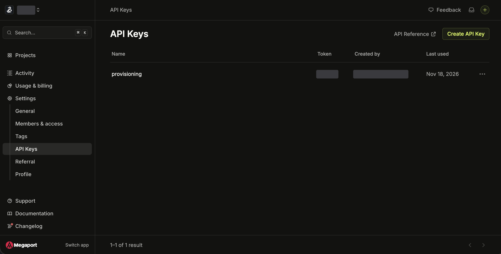
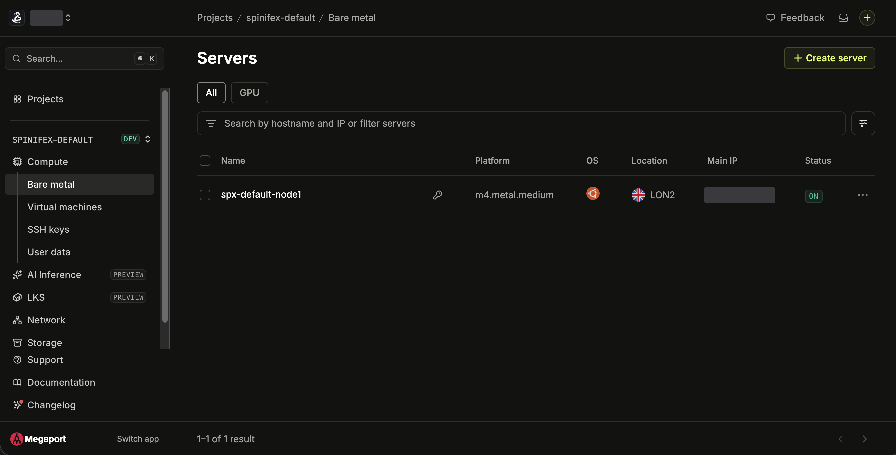
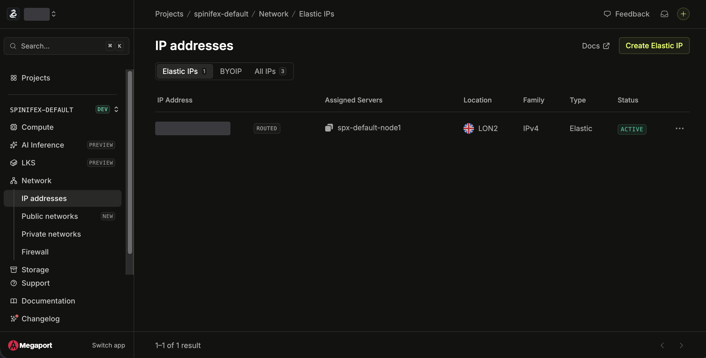
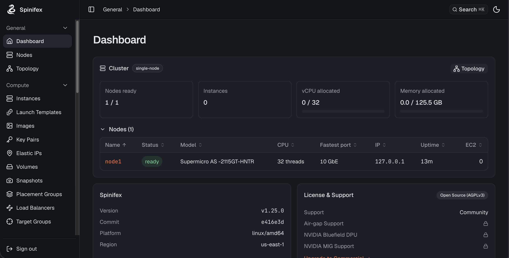
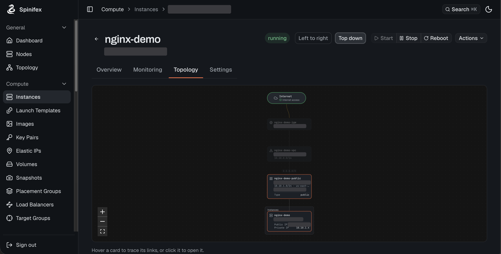

# Running Spinifex on latitude.sh

> Run the AWS surface (EC2, EBS, S3 and VPC) on a latitude.sh bare-metal server, with a guest that gets a real public address from a latitude.sh Elastic IP.

This guide was validated on Spinifex v1.25.0, on one node.

## Table of Contents

- [Overview](#overview)
- [Prerequisites](#prerequisites)
- [Instructions](#instructions)
- [1. Download Spinifex](#1-download-spinifex)
- [2. Choose a deployment](#2-choose-a-deployment)
- [3. Deploy](#3-deploy)
- [4. Check it worked](#4-check-it-worked)
- [5. Obtain AWS credentials](#5-obtain-aws-credentials)
- [6. Set up your cluster](#6-set-up-your-cluster)
- [7. Launch a website](#7-launch-a-website)
- [Removing the deployment](#removing-the-deployment)
- [Limits](#limits)
- [Troubleshooting](#troubleshooting)

## Overview

Spinifex is an open-source infrastructure platform that brings core AWS services to bare-metal, edge, and on-prem environments.
It serves the EC2, EBS, S3, VPC, IAM and STS APIs over an endpoint of your own, so the AWS CLI, the AWS SDKs and the AWS Terraform provider all work against it unmodified.

This guide runs Spinifex on one latitude.sh bare-metal server.
It is the same product you would install on your own servers with [Single-Node Install](/docs/install), so everything you build on it behaves the same wherever Spinifex runs.

**Why run it on latitude.sh:**

- **Bare metal by the hour.** Spinifex runs guests with KVM, which needs a server that exposes `/dev/kvm`, and a latitude.sh bare-metal server does.
  A virtual machine plan cannot run guests.
- **Sites in several locations.** You choose the latitude.sh site, such as `DAL` or `LON2`, so the region sits close to your users or your data.
- **Portable workloads.** Your applications and Terraform code against the AWS APIs, not against latitude.sh, so they move between latitude.sh, AWS, your own rack or an edge site as a deployment decision.
- **Keep your AWS shape.** VPCs, subnets, security groups, instances and volumes stay exactly as you define them today.

### How Spinifex uses your latitude.sh API token

On one node the token stays on your machine.
The deploy script and the Terraform provider read it from your shell to create the server and one Elastic IP, and nothing copies it to the node.
Spinifex uses that Elastic IP as a static address pool: an instance in a public subnet receives it, and it returns to the pool when the instance goes away.

## Prerequisites

You need:

- **A latitude.sh account** with room for one server and one Elastic IP.
- **A latitude.sh API key.** In the latitude.sh dashboard, open **API Keys** from your account menu and create a key.
  Export it as `LATITUDESH_AUTH_TOKEN` in [step 3](#3-deploy).
- **OpenTofu or Terraform**, version 1.6 or newer. Install [OpenTofu](https://opentofu.org/docs/intro/install/) or [Terraform](https://developer.hashicorp.com/terraform/install); the deploy script uses whichever it finds, preferring OpenTofu.
  The website workbook in [step 7](#7-launch-a-website) needs 1.6.
- **The [AWS CLI v2](https://docs.aws.amazon.com/cli/latest/userguide/getting-started-install.html)**, `python3` and `curl`.
- **No `AWS_*` variables in your shell.** Unset `AWS_ENDPOINT_URL_EC2`, `AWS_ACCESS_KEY_ID`, `AWS_SECRET_ACCESS_KEY` and `AWS_DEFAULT_REGION` if they are set, because they override the profile the deploy writes.
- **An SSH key pair** at `~/.ssh/id_ed25519`.
  Create one with `ssh-keygen -t ed25519` if you do not have one.
  The deploy installs the public key on the node.

The API keys page in the latitude.sh dashboard:

<p align="center">
  
</p>
<p align="center"><em>Create a latitude.sh API key in the dashboard.</em></p>

## Instructions

## 1. Download Spinifex

The deploy script, `deploy-latitude.sh`, is in the Spinifex repository:

```bash
git clone https://github.com/mulgadc/spinifex.git
cd spinifex/scripts/terraform/latitude-spx
```

## 2. Choose a deployment

| Use | Nodes | Plan | Cost while running |
| --- | --- | --- | --- |
| Development, testing and a first look | 1 | `m4-metal-medium` bare metal | The plan's hourly price, plus the Elastic IP's monthly price, both as latitude.sh lists them |

Check the current prices in the latitude.sh dashboard before you deploy.
latitude.sh bills a bare-metal server from the moment it is created, and a powered-off server still bills, so remove the deployment when you are done.

The installer puts Spinifex's data on the largest blank NVMe disk it finds, and in our run that was a 1.9 TB disk, the largest of three.

## 3. Deploy

`deploy-latitude.sh` is a helper script around Terraform or OpenTofu and the official [latitude.sh provider](https://registry.terraform.io/providers/latitudesh/latitudesh/latest), so the latitude.sh side of the deployment is infrastructure as code you can read, keep and change in `scripts/terraform/latitude-spx/`.
OpenTofu or Terraform creates a project, an SSH key, the server and one Elastic IP.
The script then installs Spinifex on the server over SSH and starts it.

The node runs **Ubuntu 26.04** as its host operating system, and Spinifex runs on top of it.
latitude.sh installs the operating system when it creates the server, so there is no host to prepare first.
The script installs the `latest` Spinifex release channel.

Set your API token, then run:

```bash
export LATITUDESH_AUTH_TOKEN=<your token>

./deploy-latitude.sh up
```

Bare metal is slow to arrive: in our run latitude.sh delivered the server after about 10½ minutes, and the rest of `up` took about 3½ minutes.
The default latitude.sh site is `DAL`; pass `--site` for another, with the site code in upper case, such as `--site LON2`.
Run `./deploy-latitude.sh --help` for every option.

A lower-case site, such as `--site lon2`, creates the server and then fails with `Provider produced inconsistent result after apply`.
See [Troubleshooting](#troubleshooting) to recover.

If a site has no `m4-metal-medium` in stock, the deploy stops and you pick another site with `--site`.

If a step fails, fix the cause and run the same command again: it resumes from the step that failed.

When it finishes, the deploy prints:

```ini
endpoint=https://203.0.113.10:9999
profile=spinifex-latitude-default
ca=/home/you/.spinifex/latitude-default-ca.pem
console=https://203.0.113.10:3000/
node1=203.0.113.10
elastic_ip=203.0.113.20
```

`node1` is the server's address and `elastic_ip` is the public address your first instance receives.

Before it arms the node's firewall, the deploy also prints the command for the server's out-of-band console.
Keep that command: it is how you log in if SSH is lost.

## 4. Check it worked

```bash
./deploy-latitude.sh status
```

This prints `node1` and its address, then the objects the deployment holds in your latitude.sh account by ID (the Elastic IP, project, server, SSH key and user data), then the completed deploy steps.

In the latitude.sh dashboard, the server is under your project's **Servers**, named `spx-default-node1`.
It is the server that runs Spinifex, and the AWS workloads you create on it run inside it.

<p align="center">
  
</p>
<p align="center"><em>The Spinifex node in the latitude.sh dashboard.</em></p>

The Elastic IP is under **Elastic IPs** in the same dashboard:

<p align="center">
  
</p>
<p align="center"><em>The Elastic IP the deployment created, which Spinifex hands to your first public instance.</em></p>

To log in to the node:

```bash
./deploy-latitude.sh ssh
```

## 5. Obtain AWS credentials

The deploy generated an AWS access key and secret on the node.
Display them with:

```bash
./deploy-latitude.sh credentials
```

> [!WARNING]
> This reveals an AWS secret.
> Do not redirect its output, or paste the credentials into chat, tickets, source control or logs.

The output has this shape:

```ini
[spinifex-latitude-default]
aws_access_key_id = <access-key>
aws_secret_access_key = <secret-key>
```

Use these to sign in to the web console at the `console` address the deploy printed, `https://<node1 address>:3000/`.

The deploy has also written them to an AWS profile named `spinifex-latitude-default` on your machine, with the endpoint and the cluster's certificate already set, so the AWS CLI works straight away:

```bash
export AWS_PROFILE=spinifex-latitude-default
aws ec2 describe-instance-types
```

If this returns a list of available instance types, your installation is working.

<p align="center">
  
</p>
<p align="center"><em>The Spinifex web console, on port 3000 of the node.</em></p>

**Congratulations, Spinifex is installed.**

## 6. Set up your cluster

Spinifex is running, but it holds nothing yet: no machine images, no networks, no instances.

Import the Ubuntu image on the node.
This is the import part of [Setting Up Your Cluster](/docs/setting-up-your-cluster) only; the next step creates its own network, key and instance:

```bash
./deploy-latitude.sh ssh 'spx admin images import --name ubuntu-26.04-x86_64'
```

The import took 26 seconds in our run.

Do not launch the instance from Setting Up Your Cluster as well.
A public instance holds the deployment's only Elastic IP, and the website in the next step needs it.

## 7. Launch a website

The [Nginx Web Server](/docs/nginx-webserver) workbook builds a VPC, a key pair, a security group and an Nginx instance, and gives the instance the Elastic IP.
You run it from your own machine, against the profile the deploy wrote:

```bash
cd ../../../docs/terraform-workbooks/nginx-webserver
export AWS_PROFILE=spinifex-latitude-default
tofu init
tofu apply -var region=us-east-1 \
  -var spinifex_endpoint="$(aws configure get endpoint_url)"
```

Use `terraform` in place of `tofu` if that is what you installed.
Both `-var` options are required: without them the workbook targets its default region and a local endpoint.

The apply took about 2 minutes in our run.
When it finishes, it prints `public_ip`, which equals the deploy's `elastic_ip`, and `web_url`.
Open `web_url` in a browser, or fetch it with `curl`, and the page reads "Hello from Spinifex!".

<p align="center">
  
</p>
<p align="center"><em>The website instance in its VPC, as the Spinifex console shows it.</em></p>

## Removing the deployment

Remove the website first, from the workbook directory, with the same profile and `-var` options as its apply:

```bash
export AWS_PROFILE=spinifex-latitude-default
tofu destroy -var region=us-east-1 \
  -var spinifex_endpoint="$(aws configure get endpoint_url)"
```

Without those options the destroy targets the workbook's default region and a local endpoint, and removes nothing.

Then remove the deployment from the `latitude-spx` directory:

```bash
./deploy-latitude.sh destroy
```

It shows what it will delete and asks you to type the deployment name, `default`, to confirm.
It deletes the server, the Elastic IP, the SSH key, the user data and the project, each by the ID it recorded.
Objects whose names match the deployment but that it did not record are listed, and are deleted only after you type `delete-untracked`.

The Elastic IP list in the latitude.sh API ignores pagination, so the last step asks you to check the dashboard for leftovers and to type `checked`.
Look under **Servers** and **Elastic IPs** before you do.
In our run the destroy took about 1½ minutes, including both prompts, and left nothing behind.

## Limits

- **One node.** Three nodes are not supported yet, because an Elastic IP does not yet move to another server when a node fails.
- **One public address, so one public instance.** The deployment holds a single Elastic IP, and each instance in a public subnet needs one.
  A second public instance, or a load balancer that needs public addresses, has no address to take.
- **Five Elastic IPs per team.** latitude.sh raises the limit on request to support.

## Troubleshooting

| Symptom | Cause and fix |
| --- | --- |
| `Provider produced inconsistent result after apply ... .site` after the server was created | The site was passed in lower case. The server exists and Terraform recorded it as tainted. Run `tofu untaint 'latitudesh_server.node[0]'` against `~/.spinifex/latitude/default/terraform.tfstate`, then run `./deploy-latitude.sh up --site <UPPER-CASE SITE>` again, and it keeps the server. Or run `./deploy-latitude.sh destroy` and then `up`. |
| The site has no `m4-metal-medium` in stock | Pick another site with `--site`, in upper case. |
| `Connection was closed before we received a valid response from endpoint URL: "http://127.0.0.1:8080/"` | `AWS_ENDPOINT_URL_EC2`, `AWS_ACCESS_KEY_ID`, `AWS_SECRET_ACCESS_KEY` or `AWS_DEFAULT_REGION` is set in your shell and overrides the profile. Run `unset` on each, then `export AWS_PROFILE=spinifex-latitude-default`. |
| The workbook targets the wrong region or a local endpoint | Pass `-var region=us-east-1` and `-var spinifex_endpoint="$(aws configure get endpoint_url)"` to both `apply` and `destroy`. |
| SSH to the node stops answering | Use the out-of-band console command the deploy printed, or the Out-of-Band tab on the server in the latitude.sh dashboard. Logging in there needs an OS user password, which you set yourself while SSH still works. |
| Any other failure | The logs are under `~/.spinifex/latitude/default/`. `up` resumes from the failed step. |
