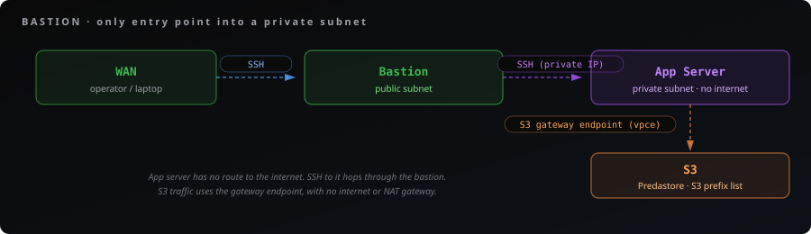

# Terraform: Bastion with Private Subnet

> Deploy a bastion host to access an isolated private compute instance with no internet connectivity.

## Table of Contents

- [Overview](#overview)
- [Instructions](#instructions)
- [Troubleshooting](#troubleshooting)

---

## Overview

Deploy a VPC with public and private subnets where the private subnet has no internet access. A bastion host in the public subnet is the only way to reach instances in the private subnet. This pattern is used for sensitive workloads that must remain isolated from the internet.
The private instance cannot make or receive connections to the internet.
It reaches S3 through an S3 gateway VPC endpoint on its route table, so its S3 traffic does not need an internet or NAT gateway.

**Architecture:**

<p align="center">
  
</p>

**What you'll learn:**

- Creating public and private subnets in a VPC
- Isolating compute instances from the internet using route tables and security groups
- Using a bastion host as the sole access point to private resources
- SSH hopping through a bastion to reach private instances
- Reaching S3 from a private subnet through a gateway VPC endpoint and the S3 prefix list

**Use cases:**

- Sensitive data processing that must not have internet egress
- Internal services that should only be reachable within the VPC
- Compliance workloads requiring network isolation

**Prerequisites:**

- Spinifex installed and running (see [Installing Spinifex](/docs/install))
- An Ubuntu 26.04 AMI imported (see [Setting Up Your Cluster](/docs/setting-up-your-cluster))
- OpenTofu or Terraform installed
- The S3 gateway endpoint service offered by the cluster: `aws ec2 describe-vpc-endpoint-services --profile spinifex` must list `com.amazonaws.<region>.s3`. The cluster offers the service when every node reports feature level 2 in `spx admin cluster status`.

## Instructions

### Step 1. Get the Template

Clone the Terraform examples from the Spinifex repository:

```bash
git clone --depth 1 --filter=blob:none --sparse https://github.com/mulgadc/spinifex.git spinifex-tf
cd spinifex-tf
git sparse-checkout set docs/terraform-workbooks
cd docs/terraform-workbooks/bastion-private-subnet
```

Or create a `main.tf` file and paste the full configuration below.

<!-- INCLUDE: main.tf lang:hcl -->

### Step 2. Deploy

The workbook defaults to `t3.small` (2 vCPU, 2 GiB) for both bastion and private instance. On clusters without that type registered, override with `TF_VAR_instance_type` — query what's available with `aws ec2 describe-instance-types`.

```bash
export AWS_PROFILE=spinifex
tofu init
tofu apply
```

### Step 3. Connect

> **Note:** EC2 instances can take 30+ seconds to boot after apply. If SSH is unreachable, wait and retry.

SSH into the bastion:

```bash
ssh -i bastion-demo.pem ubuntu@<bastion_public_ip>
```

From the bastion, SSH to the private instance. The key is pre-installed at `~/.ssh/bastion-demo.pem` via cloud-init:

```bash
ssh -i ~/.ssh/bastion-demo.pem ubuntu@<private_ip>
```

### Step 4. Verify Isolation

From the private instance, confirm there is no internet connectivity:

```bash
# This should time out — the private instance has no route to the internet
curl --connect-timeout 5 https://deb.debian.org || echo "No internet access (expected)"
```

The private instance can communicate within the VPC (`10.20.0.0/16`) and with S3 through the gateway endpoint.
Its security group allows egress to the VPC, and to the S3 prefix list on the S3 port.

### Step 5. Verify S3 Access Through the Endpoint

On your workstation, print the command:

```bash
tofu output -raw s3_check_from_private
```

Run the printed command on the private instance. It has the form `curl -sk https://<s3_gateway_address>:<s3_gate_port>/`, with the address and port that the workbook uses.

The request is unsigned, so S3 answers with an `AccessDenied` error document.
That answer shows that the private instance reaches S3 through the endpoint with no internet route.
A signed request, for example from the AWS CLI with credentials, lists your buckets.

> **Note:** On AWS, S3 is at `s3.<region>.amazonaws.com` on port 443. On Spinifex, use an address from the `s3_gateway_addresses` output and the port from the `s3_gate_port` output (8443 by default). The security group egress rule uses the same port.
> `-k` turns off certificate verification, because the S3 gateway presents a certificate from the cluster CA. `--cacert` with the cluster CA verifies the certificate only if the certificate names the address that you dial.

### Clean Up

```bash
tofu destroy
```

## Troubleshooting

### Cannot SSH to Private Instance

The private instance has no public IP — it is only reachable from the bastion. SSH to the bastion first, then use the pre-installed key to hop:

```bash
ssh -i bastion-demo.pem ubuntu@<bastion_ip>
ssh -i ~/.ssh/bastion-demo.pem ubuntu@<private_ip>
```

If the key is missing on the bastion, check that cloud-init completed successfully:

```bash
sudo journalctl -u cloud-init --no-pager
ls -la ~/.ssh/bastion-demo.pem
```

### Private Instance Can Reach the Internet

If the private instance unexpectedly has internet access, check that its route table has no default route:

```bash
aws ec2 describe-route-tables --profile spinifex
```

The private route table should have no `0.0.0.0/0` route. Its only route out of the VPC is from the S3 prefix list (`pl-`) to the gateway endpoint (`vpce-`).
Also verify that the private security group egress allows only the VPC CIDR (`10.20.0.0/16`), and the S3 prefix list on the S3 port.

### InvalidServiceName on Apply

The apply fails on `aws_vpc_endpoint.s3`, or the `aws_vpc_endpoint_service` data source finds no service, when the cluster does not offer the S3 gateway endpoint service yet.
Check that `aws ec2 describe-vpc-endpoint-services --profile spinifex` lists `com.amazonaws.<region>.s3`. Use `spx admin cluster status` to find the node that has not reached feature level 2.

### S3 Check Times Out or Resets

A timeout or a reset connection is a symptom, and more than one fault causes each. Do these checks:

1. The private route table is associated with the endpoint:

   ```bash
   aws ec2 describe-vpc-endpoints --profile spinifex --query 'VpcEndpoints[].RouteTableIds'
   ```

2. The private security group allows egress to the S3 prefix list on the gate port:

   ```bash
   aws ec2 describe-security-groups --profile spinifex --filters Name=group-name,Values=bastion-demo-private-sg --query 'SecurityGroups[].IpPermissionsEgress'
   ```

3. You dial an address from the `s3_gateway_addresses` output on the port from the `s3_gate_port` output, and that port is the port that S3 serves on in your cluster.

### AMI Not Found

Ensure you have imported an Ubuntu 26.04 image:

```bash
aws ec2 describe-images --owners 000000000000 --profile spinifex
```
