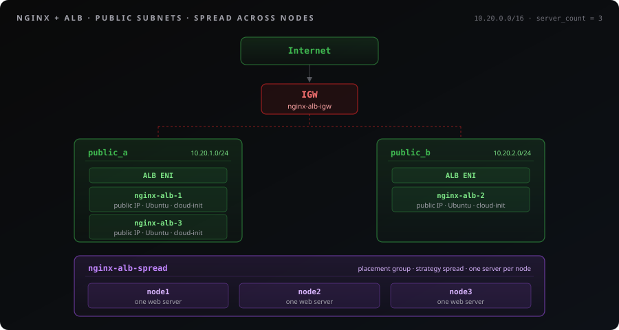

# Terraform: Nginx Web Servers with ALB

> Deploys Nginx web server instances behind an Application Load Balancer on Spinifex, optionally spread one per node so the site survives losing a node.

## Table of Contents

- [Overview](#overview)
- [Instructions](#instructions)
- [Troubleshooting](#troubleshooting)

---

## Overview

Deploy Nginx web servers behind an internet-facing Application Load Balancer on Spinifex using Terraform or OpenTofu.
This workbook provisions a VPC with two public subnets, an internet gateway, a route table, a security group, an SSH key pair, an Application Load Balancer (ALB) and two or more EC2 instances with cloud-init user-data that installs and starts Nginx.
The web servers get public IPs so cloud-init can install Nginx, and the ALB reaches them over the VPC by their private addresses.

On a cluster of three or more nodes, a spread placement group puts each web server on a different node.
Losing a node then takes out at most one server, the ALB stops sending it traffic, and Spinifex restarts the lost instances on the surviving nodes.
[Step 6](#step-6-test-resiliency) shows how to watch that happen.

<p align="center">
  
</p>

**What you'll learn:**

- Configuring the AWS Terraform provider to target Spinifex
- Creating a VPC with public subnets and an internet gateway
- Provisioning an internet-facing ALB in front of a group of web servers
- Provisioning EC2 instances with cloud-init user-data
- Spreading instances across nodes with a placement group
- Generating SSH key pairs with the TLS provider

**What gets created**

| Resource | Name | Purpose |
|---|---|---|
| VPC | `nginx-alb-vpc` | Isolated network (10.20.0.0/16) |
| Public Subnets | `nginx-alb-public-a`, `nginx-alb-public-b` | Host the ALB and the web servers |
| Internet Gateway | `nginx-alb-igw` | Routes internet traffic for the public subnets |
| Security Group | `nginx-alb-sg` | Allows SSH (22) and HTTP (80) inbound |
| Placement Group | `nginx-alb-spread` | Only with `placement_strategy`; spread puts one web server per node |
| EC2 Instances | `nginx-alb-1`, `nginx-alb-2`, … | Ubuntu with Nginx via cloud-init, one per `server_count` |
| ALB | `nginx-alb` | Internet-facing Application Load Balancer on port 80 |
| Target Group | `nginx-alb-tg` | HTTP health-checked group of every web server |
| Listener | HTTP :80 | Forwards traffic to the target group |

**Variables**

| Variable | Default | Purpose |
|---|---|---|
| `instance_type` | `t3.small` | Instance type of the web servers |
| `server_count` | `2` | Number of web servers behind the ALB |
| `placement_strategy` | none | `spread` puts each web server on a different node; `cluster` puts them all on one |
| `region` | `ap-southeast-2` | Spinifex region |
| `spinifex_endpoint` | `https://127.0.0.1:9999` | Spinifex AWS endpoint |

A spread placement group on Spinifex spreads across nodes, so `server_count` can be at most the number of nodes in the cluster.

**Prerequisites:**

- Spinifex installed and running (see [Installing Spinifex](/docs/install))
- An Ubuntu 26.04 or 24.04 AMI imported (see [Setting Up Your Cluster](/docs/setting-up-your-cluster))
- OpenTofu or Terraform installed
- For [Step 6](#step-6-test-resiliency), a cluster of three nodes

## Instructions

### Step 1. Get the Template

Clone the Terraform examples from the Spinifex repository:

```bash
git clone --depth 1 --filter=blob:none --sparse https://github.com/mulgadc/spinifex.git spinifex-tf
cd spinifex-tf
git sparse-checkout set docs/terraform-workbooks
cd docs/terraform-workbooks/nginx-alb
```

Or create a `main.tf` file and paste the full configuration below.

<!-- INCLUDE: main.tf lang:hcl -->

### Step 2. Import the Ubuntu AMI

Import the Ubuntu 26.04 AMI the web servers run on, from any node of the cluster:

```bash
spx admin images import --name ubuntu-26.04-x86_64
```

> **Note:** The load balancer itself runs as a direct-boot QEMU microvm using the kernel + initramfs bundled with the Spinifex distribution (`/usr/share/spinifex/microvm/`), so no separate LB AMI import is required.

### Step 3. Deploy

```bash
export AWS_PROFILE=spinifex
tofu init
```


### Step 4. Specify instance and apply

Next, depending on your architecture and CPU/memory requirements you must specify an instance type to launch.

Either specify an instance type directly (e.g Intel)

```bash
# AMD instance
export TF_VAR_instance_type="t3a.small"

# Or, Intel
export TF_VAR_instance_type="t3.small"
```

Or alternatively, using the AWS CLI tool query your instance for available types (e.g Intel, AMD, ARM) that support 2 vCPUs and 1 GB RAM.

```bash
export TF_VAR_instance_type=$(aws ec2 describe-instance-types \
  --query "sort_by(InstanceTypes[?VCpuInfo.DefaultVCpus==\`2\` && MemoryInfo.SizeInMiB>=\`1024\`], &MemoryInfo.SizeInMiB)[0].InstanceType" \
  --output text)
```

Next, apply and launch the template:

```bash
tofu apply
```

On a three-node cluster, launch three web servers instead, one on each node:

```bash
tofu apply -var server_count=3 -var placement_strategy=spread
```

### Step 5. Verify

> **Note:** EC2 instances can take 30+ seconds to boot after apply, and Nginx installs after that.
> If the ALB returns 5xx or HTTP is unreachable, wait and retry, since the target group health checks need a moment to mark the instances healthy once Nginx has installed.

The ALB is internet-facing, but the DNS name Spinifex returns (`*.elb.spinifex.local`) will not resolve from your host. Fetch the ALB's public IP with the AWS CLI:

```bash
ALB_IP=$(aws elbv2 describe-load-balancers --names nginx-alb \
  --query 'LoadBalancers[0].AvailabilityZones[].LoadBalancerAddresses[].IpAddress' \
  --output text)
```

Then hit the ALB, and successive requests rotate between the servers:

```bash
curl http://$ALB_IP
curl http://$ALB_IP
```

Open `http://$ALB_IP` in your browser and refresh to see the page alternate content served from each instance.

Each web server also has a public IP of its own, listed by `tofu output instance_public_ips`.
The ALB reaches them by their private IPs, listed by `tofu output instance_private_ips`.

Check target health via AWS CLI:

```bash
TG_ARN=$(aws elbv2 describe-target-groups \
  --query 'TargetGroups[0].TargetGroupArn' \
  --output text)

aws elbv2 describe-target-health --target-group-arn $TG_ARN
```

### Step 6. Test resiliency

On a cluster of three nodes, apply with `-var server_count=3 -var placement_strategy=spread`, then check that each web server is on its own node:

```bash
spx get vms
```

The `NODE` column names each node once for the three `t3.small` web servers, and the load balancer is the `sys.micro` instance.

Request the page once a second in a second terminal:

```bash
while :; do
  printf '%s %s\n' "$(date +%T)" "$(curl -s -m2 "http://$ALB_IP/" | grep -o 'Server [0-9]' || echo FAILED)"
  sleep 1
done
```

Then power off one node, the way a hardware failure would, without shutting it down first.
On Vultr, `deploy-vultr.sh stop node3` does this, as described in [Running Spinifex on Vultr](/docs/vultr-integration#8-test-resiliency).

Within about a minute the load balancer stops sending requests to the lost web server, and the other two answer every request.
About three minutes after the power-off, Spinifex has restarted the lost web server on a surviving node with the same instance ID, private IP and public IP, and the load balancer sends it requests again once its health checks pass.
Power the node back on and wait until `spx get nodes` shows it `Ready` before you test another node.

### Cleanup

```bash
tofu destroy
```

If you applied with `-var` options, pass the same ones to `tofu destroy`.

## Troubleshooting

### AMI Not Found

Ensure you have imported an Ubuntu 26.04 image. Check available AMIs:

```bash
aws ec2 describe-images --owners 000000000000 --profile spinifex
```

If missing import:

```bash
spx admin images import --name ubuntu-26.04-x86_64
```

### Provider Connection Refused

Verify Spinifex services are running:

```bash
sudo systemctl status spinifex.target
curl -k https://localhost:9999/
```

### ALB Returns 5xx / Targets Unhealthy

Give the instances a moment to finish cloud-init (Nginx has to install before it can answer health checks). Check target health:

```bash
TG_ARN=$(aws elbv2 describe-target-groups --names nginx-alb-tg \
  --query 'TargetGroups[0].TargetGroupArn' --output text)
aws elbv2 describe-target-health --target-group-arn "$TG_ARN"
```

If targets stay unhealthy, verify the instances are running:

```bash
aws ec2 describe-instances --profile spinifex
```

If cloud-init on the workers never finished, SSH to one by its public IP and read its log, as described in [Nginx Not Responding](#nginx-not-responding).

### Nginx Not Responding

SSH to the web server by its public IP, from `tofu output instance_public_ips`, and check cloud-init and Nginx:

```bash
ssh -i nginx-alb-demo.pem ubuntu@<instance_public_ip>
sudo journalctl -u cloud-init --no-pager
sudo systemctl status nginx
```

### Spread Launch Fails With InsufficientInstanceCapacity

A spread placement group puts at most one of its instances on each node.
Set `server_count` no higher than the number of nodes, or leave `placement_strategy` empty.
