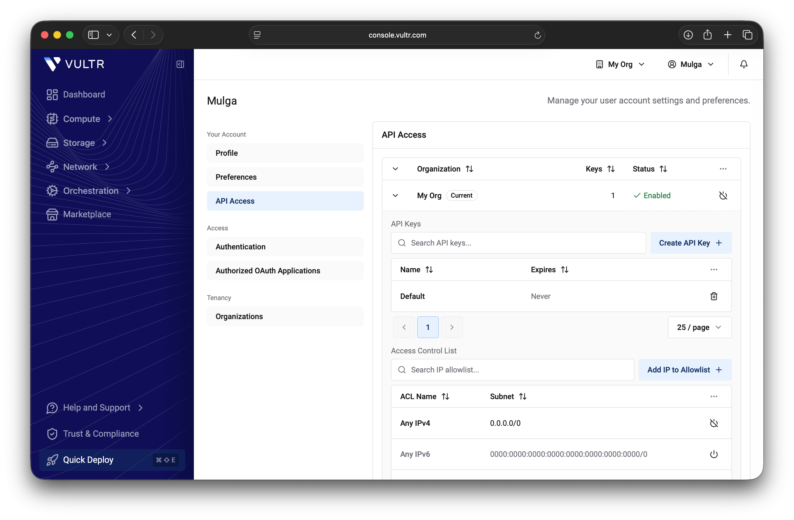
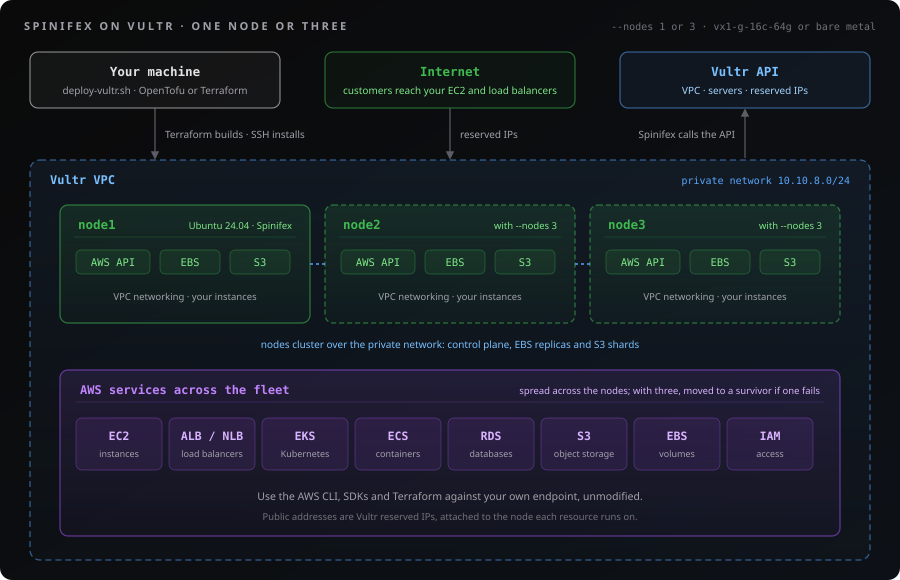
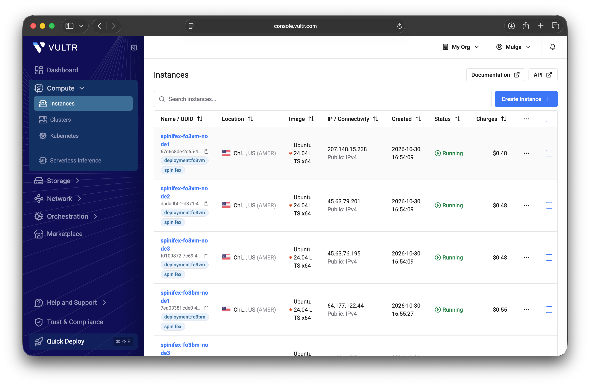

# Running Spinifex on Vultr

> Run the AWS surface (EC2, EBS, S3, VPC, load balancers and EKS) on Vultr, with guests that get real public addresses through Vultr's own API.

## Table of Contents

- [Overview](#overview)
- [Prerequisites](#prerequisites)
- [Instructions](#instructions)
- [1. Download Spinifex](#1-download-spinifex)
- [2. Choose a deployment](#2-choose-a-deployment)
- [3. Deploy](#3-deploy)
- [4. Restrict the API key](#4-restrict-the-api-key)
- [5. Check it worked](#5-check-it-worked)
- [6. Obtain AWS credentials](#6-obtain-aws-credentials)
- [7. Set up your cluster](#7-set-up-your-cluster)
- [8. Test resiliency](#8-test-resiliency)
- [Removing the deployment](#removing-the-deployment)
- [Limits](#limits)
- [Troubleshooting](#troubleshooting)

## Overview

Spinifex is an open-source infrastructure platform that brings core AWS services to bare-metal, edge, and on-prem environments.
It serves the EC2, EBS, S3, VPC, IAM and STS APIs, plus load balancers and EKS, over an endpoint of your own, so the AWS CLI, the AWS SDKs and the AWS Terraform provider all work against it unmodified.

This guide runs Spinifex on Vultr, on one node or three, on VMs or on bare metal.
It is the same product you would install on your own servers with [Single-Node Install](/docs/install), so everything you build on it behaves the same wherever Spinifex runs.

**Why run it on Vultr:**

- **A global network.** Vultr has 33 locations across six continents, so you can put an AWS-compatible region close to your users or your data.
- **Compute when you need it.** VMs and bare metal are available by the hour in most Vultr locations, with no long-term commitment.
- **Flexibility.** Start on one VM for development, then move to three nodes or bare metal for production with the same command.
- **Portable workloads.** Your applications and Terraform code against the AWS APIs, not against Vultr, so they move between Vultr, AWS, your own rack or an edge site as a deployment decision.
- **Keep your AWS shape.** VPCs, subnets, security groups, instances, volumes and load balancers stay exactly as you define them today.
  No rewrite of your application or your infrastructure code is required.

### How Spinifex uses your Vultr API key

Spinifex includes Vultr support, which needs a Vultr API key to provide public networking.
Whenever something you create on Spinifex needs a public address, such as an EC2 instance in a public subnet, an Elastic IP, an internet-facing load balancer or a NAT gateway, Spinifex creates a Vultr reserved IP through the API, attaches it to the node the resource runs on, and routes it to that resource.
It deletes the reserved IP again when the resource goes away.

The key is copied to the nodes over SSH and stored at `/etc/spinifex/vultr/api-key`, readable only by the Spinifex daemon.
It is never written to the Terraform state or to the instance metadata.

## Prerequisites

You need:

- **A Vultr account** with room for the nodes you choose in [step 2](#2-choose-a-deployment).
- **A Vultr API key.** In the Vultr portal, open your user menu, then **API Access**, and under your organization choose **Create API Key**.
  Under **Access Control List**, choose **Add IP to Allowlist** and add `0.0.0.0/0` for now.
  The nodes call the API to manage their addresses, and their addresses do not exist until the deploy creates them.
  You replace `0.0.0.0/0` with the real addresses in [step 4](#4-restrict-the-api-key).
- **OpenTofu or Terraform**, version 1.5 or newer. Install [OpenTofu](https://opentofu.org/docs/intro/install/) or [Terraform](https://developer.hashicorp.com/terraform/install); the deploy script uses whichever it finds, preferring OpenTofu.
- **The [AWS CLI v2](https://docs.aws.amazon.com/cli/latest/userguide/getting-started-install.html)** and `python3`.
- **An SSH key pair** at `~/.ssh/id_ed25519`.
  Create one with `ssh-keygen -t ed25519` if you do not have one.
  The deploy installs the public key on every node.

The API key page, with the key and the temporary `0.0.0.0/0` entry in its access control list:

<p align="center">
  
</p>
<p align="center"><em>Create a Vultr API key in the web console, with 0.0.0.0/0 allowed until the deploy finishes.</em></p>

## Instructions

## 1. Download Spinifex

The deploy script, `deploy-vultr.sh`, is in the Spinifex repository:

```bash
git clone https://github.com/mulgadc/spinifex.git
cd spinifex
git switch dev
cd scripts/terraform/vultr-spx
```

> [!NOTE]
> Vultr support is on the development branch and not yet in a published release.
> `git switch dev` gives you the deploy script for it, and `--channel dev` in [step 3](#3-deploy) installs the matching Spinifex build, the pre-release published from every change to `dev`.
> Once Vultr support is in a release, skip `git switch dev` and pass `--channel latest`.

## 2. Choose a deployment

| Use | Nodes | Plan | Cost while running |
| --- | --- | --- | --- |
| Development and testing | 1 | `vx1-g-16c-64g` VM (16 vCPU, 64 GB) | $0.48 an hour |
| Production | 3 | `vx1-g-16c-64g` VM | $1.44 an hour |
| Production on bare metal | 1 or 3 | `vbm-8c-64gb-amd` bare metal (8 cores, 16 threads, 64 GB, 2 × 1.9 TB NVMe) | $0.55 an hour per server |

**For development and testing, use one `vx1-g-16c-64g` VM.** It is the smallest size we recommend, because the EC2 instances, load balancers, EKS and ECS clusters you create all run inside it and need headroom.
Spinifex keeps 2 of its 16 vCPUs for the host and its own services and offers the other 14 to what you create, one vCPU each, with no overcommit.

**For production, use three VMs, or bare metal.** On three nodes, an instance whose node fails is restarted on another node, and its public address follows it.
`vbm-8c-64gb-amd` is the smallest bare-metal server we recommend for production workloads, as one server or as three.

Bare metal takes longer to deliver than a VM, and Vultr bills a bare-metal server from the moment it is created, whether it is running or stopped.

## 3. Deploy

`deploy-vultr.sh` is a helper script around Terraform or OpenTofu and the official [Vultr provider](https://registry.terraform.io/providers/vultr/vultr/latest), so the Vultr side of the deployment is infrastructure as code you can read, keep and change in `scripts/terraform/vultr-spx/`.
OpenTofu or Terraform creates a private Vultr VPC and the nodes.
The script then installs Spinifex on every node over SSH and forms the cluster.

<p align="center">
  
</p>
<p align="center"><em>One node or three in a private Vultr VPC, running AWS services across the fleet.</em></p>

Each node runs **Ubuntu 24.04 LTS** as its host operating system, and Spinifex runs on top of it.
Vultr installs the operating system when it creates the node, so there is no host to prepare first.

Set your API key, then run the command for the deployment you chose:

```bash
export VULTR_API_KEY=<your key>

# Development and testing: one VM
./deploy-vultr.sh up --channel dev --plan vx1-g-16c-64g

# Production: three VMs
./deploy-vultr.sh up --channel dev --plan vx1-g-16c-64g --nodes 3

# Production on bare metal: one server, or three
./deploy-vultr.sh up --channel dev --plan vbm-8c-64gb-amd
./deploy-vultr.sh up --channel dev --plan vbm-8c-64gb-amd --nodes 3
```

One VM takes about 4 minutes and three VMs about 16 minutes.
Bare metal is slower, because Vultr takes 5 to 6 minutes to deliver a server: one server took 10 minutes in our test, and three took 18½.
The default Vultr region is `ord` (Chicago); pass `--region` for another, and run `./deploy-vultr.sh --help` for every option.

If a step fails, fix the cause and run the same command again: it resumes from the step that failed.

When it finishes, the deploy prints:

```ini
endpoint=https://203.0.113.10:9999
profile=spinifex
ca=/home/you/.spinifex/vultr-default-ca.pem
console=https://203.0.113.10:3000/
node1=203.0.113.10
api_key_allowlist=203.0.113.10/32
```

A three-node deployment lists `node2` and `node3` as well, and all three addresses in `api_key_allowlist`.

## 4. Restrict the API key

Now that the node addresses are known, close the API key to everything else.
In the Vultr portal, open your user menu, then **API Access**, and under **Access Control List**:

1. Choose **Add IP to Allowlist** for each address from the `api_key_allowlist` line.
2. Add your own machine's public address, so that `./deploy-vultr.sh` can still remove the deployment later.
3. Remove the `0.0.0.0/0` entry, and the IPv6 `::/0` entry if your list has one.

`./deploy-vultr.sh status` prints the node addresses again whenever you need them.

## 5. Check it worked

```bash
./deploy-vultr.sh status
```

This lists each node and its address, then every VM or bare-metal server, VPC, volume and reserved IP the deployment holds in your Vultr account, then the completed deploy steps.

In the Vultr portal, the nodes are under **Compute → Instances**, bare-metal servers included.
Each is named `spinifex-<deployment>-nodeN` and tagged `spinifex` and `deployment:<deployment>`, which is `deployment:default` unless you passed `--name`.
These are the servers that run Spinifex, and the AWS workloads and services you create on it run inside them.

<p align="center">
  
</p>
<p align="center"><em>Spinifex nodes in the Vultr console, tagged with their deployment.</em></p>

To log in to a node:

```bash
./deploy-vultr.sh ssh            # node1
./deploy-vultr.sh ssh node2      # another node of a three-node deployment
```

For a three-node deployment, check that every node has joined:

```bash
./deploy-vultr.sh ssh 'spx get nodes'
```

Expect three nodes with `Ready` status:

```text
NAME  │ STATUS │ ROLES         │ IP        │ REGION    │ AZ         │ UPTIME │ VMs │ SERVICES
──────────────────────────────────────────────────────────────────────────────────────────────────────────────────
node1 │ Ready  │ nats:leader   │ 10.10.8.5 │ us-east-1 │ us-east-1a │ 12m    │ 0   │ nats,predastore,viperblock,daemon,awsgw,vpcd,ui
node2 │ Ready  │ nats:follower │ 10.10.8.4 │ us-east-1 │ us-east-1a │ 11m    │ 0   │ nats,predastore,viperblock,daemon,awsgw,vpcd,ui
node3 │ Ready  │ nats:follower │ 10.10.8.3 │ us-east-1 │ us-east-1a │ 11m    │ 0   │ nats,predastore,viperblock,daemon,awsgw,vpcd,ui
```

## 6. Obtain AWS credentials

The deploy generated an AWS access key and secret on node 1.
Display them with:

```bash
./deploy-vultr.sh credentials
```

> [!WARNING]
> This reveals an AWS secret.
> Do not redirect its output, or paste the credentials into chat, tickets, source control or logs.

The output has this shape:

```ini
[spinifex]
aws_access_key_id = <access-key>
aws_secret_access_key = <secret-key>
```

Use these to sign in to the web console at the `console` address the deploy printed, `https://<node1 address>:3000/`.

The deploy has also written them to an AWS profile named `spinifex` on your machine, with the endpoint and the cluster's certificate already set, so the AWS CLI works straight away:

```bash
export AWS_PROFILE=spinifex
aws ec2 describe-instance-types
```

The same profile is set up on node 1, if you prefer to work from there:

```bash
./deploy-vultr.sh ssh 'export AWS_PROFILE=spinifex; aws ec2 describe-instance-types'
```

If this returns a list of available instance types, your installation is working.

<p align="center">
  
</p>
<p align="center"><em>The Spinifex web console, on port 3000 of node 1.</em></p>

**Congratulations, Spinifex is installed.**

## 7. Set up your cluster

Spinifex is running, but it holds nothing yet: no machine images, no networks, no instances.

Continue to [Setting Up Your Cluster](/docs/setting-up-your-cluster) to import an AMI, create an SSH key pair, create a VPC with a public subnet, and launch your first instance.
An instance you launch into a public subnet gets a Vultr reserved IP, which you can see in the Vultr portal under **Network → Reserved IPs**.

## 8. Test resiliency

A three-node deployment is for high availability: it protects your workloads against any one machine going down.
The three nodes form one cluster, a lightweight AWS region on Vultr, and the cluster and everything on it keep running when a node fails.
Spinifex restarts the failed node's instances on the surviving nodes, and moves each instance's Vultr reserved IP with it, so its public address keeps working.
To watch it happen, run a load-balanced website across the three nodes, then power one of them off.

### Launch a website on every node

Import the Ubuntu image the web servers run on:

```bash
./deploy-vultr.sh ssh 'spx admin images import --name ubuntu-26.04-x86_64'
```

The [Nginx Web Server (Load Balanced)](/docs/nginx-alb) workbook launches web servers behind an Application Load Balancer.
With these two variables it launches three, and a spread placement group puts each one on a different node:

```bash
cd docs/terraform-workbooks/nginx-alb
export AWS_PROFILE=spinifex
tofu init
tofu apply -var region=us-east-1 \
  -var spinifex_endpoint="$(aws configure get endpoint_url)" \
  -var server_count=3 -var placement_strategy=spread
```

Use `terraform` in place of `tofu` if that is what you installed.
Check that each web server is on its own node:

```bash
../../../scripts/terraform/vultr-spx/deploy-vultr.sh ssh 'spx get vms'
```

The `NODE` column shows `node1`, `node2` and `node3` once each, and the load balancer is the `sys.micro` instance.

### Keep requests running

Get the load balancer's address, and request the page once a second in a second terminal:

```bash
ALB_IP=$(aws elbv2 describe-load-balancers --names nginx-alb \
  --query 'LoadBalancers[0].AvailabilityZones[].LoadBalancerAddresses[].IpAddress' --output text)
while :; do
  printf '%s %s\n' "$(date +%T)" "$(curl -s -m2 "http://$ALB_IP/" | grep -o 'Server [0-9]' || echo FAILED)"
  sleep 1
done
```

Each line names the web server that answered.

### Power off a node

From the `vultr-spx` directory, power off a node that runs a web server but not the load balancer:

```bash
./deploy-vultr.sh stop node3
```

This is a hard power-off through the Vultr API, as a hardware failure would be, so the node hands nothing over first.
Watch the requests and `spx get vms`:

1. For up to about a minute, a few requests fail while the load balancer's health checks find that one web server is gone.
2. After that, the other two web servers answer every request.
3. About three minutes after the power-off, the lost web server is `running` on one of the surviving nodes.
4. About four minutes after the power-off, its own public address answers again, and the load balancer sends it requests once its health checks pass.

Power the node back on:

```bash
./deploy-vultr.sh start node3
```

It rejoined the cluster about a minute after a VM started, and about five minutes after a bare-metal server started.
Wait until `spx get nodes` shows it `Ready` before you power off another node.
The instances that moved stay where they are.

### What we measured

On three `vx1-g-16c-64g` VMs and on three `vbm-8c-64gb-amd` bare-metal servers in Chicago, with the workbook above:

| Node powered off | Deployment | Instance `running` elsewhere | Its public address answers | Load balancer requests failed |
| --- | --- | --- | --- | --- |
| A node with one web server | VMs | 173 s | 244 s | 5 of 91, all within 45 s |
| A node with one web server | Bare metal | 172 s | 223 s | 6 of 83, all within 60 s |
| node1, with a web server, the load balancer and the cluster's NATS leader | VMs | 167 s | 253 s | 22 of 66, all within 115 s |
| A node with two web servers and the load balancer | Bare metal | 204 s | 271 s | 21 of 79, all within 114 s |

Each case was measured once.
The requests column counts one-second probes, so a run with more timed-out requests sends fewer of them.
The load balancer recovers first, because it moves to a surviving node like any other instance.
While node1 is off, the AWS endpoint in your `spinifex` profile does not answer, because it is node1's address.
Call another node meanwhile by adding `--endpoint-url https://<node2-address>:9999` to an `aws` command.

When you are done, remove the workbook with `tofu destroy` and the same `-var` options before [removing the deployment](#removing-the-deployment).

## Removing the deployment

Remove anything you built on the cluster first, then:

```bash
./deploy-vultr.sh destroy
```

It shows what it will delete and asks you to type the deployment name, `default`, to confirm.
It deletes the nodes and the VPC, plus anything else the deployment left in your Vultr account that keeps billing: VM boot volumes, and any reserved IP Spinifex created.
When it finishes, nothing of the deployment is left, and if anything is, it lists it and fails.

After removing the deployment, remove the node addresses from the API key's **Access Control** list, since Vultr may give them to someone else.

## Limits

- **One or three nodes.** Other cluster sizes are not supported.
- **16 vCPU per node is the recommended minimum.** On a 16-vCPU node, Spinifex keeps 2 vCPU for the OS and its own services, and the other 14 are available for your EC2 instances and AWS services.
- **A deleted reserved IP keeps its quota slot for 24 hours**, by Vultr's documentation, so creating and deleting many addresses in a day can reach the account's limit.
- **A three-node deployment survives one failed node at a time.** The cluster needs a majority of its nodes, two of three, online to keep running.

## Troubleshooting

| Symptom | Cause and fix |
| --- | --- |
| `the API key was refused; check its IP allowlist` | Your machine's address is not in the key's **Access Control** list. Add it in the portal. |
| `the node's API calls are refused` or `never logged its Vultr allocator` | A node's address is not in the key's **Access Control** list. Add `0.0.0.0/0` until the deploy finishes, then follow [step 4](#4-restrict-the-api-key), and run `up` again. |
| `plan ... is not available in this region` | Pick another region with `--region`, or check the plan's availability in the Vultr portal. |
| `formation failed` | The full log is in `~/.spinifex/vultr/default/form.log`. Run `up` again once the cause is fixed. |
| Any other failure | The logs are under `~/.spinifex/vultr/default/`, and the message names the log on the node. `up` resumes from the failed step. |
